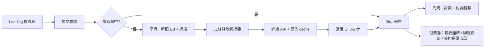

# Renocheck MVP 設計書

> **產品代號：** Renocheck（Notion：`MVP project-裝修點評`）  
> **一句話：** 全港首個獨立、客觀、站在業主防禦立場的「裝修公司信用與風險情報搜尋引擎」——裝修界的 TU / 防呃情報搜尋。

**Notion 來源：** [MVP project-裝修點評](https://app.notion.com/p/3f63e97febe9809ebb29c1fb43c3c331)

---

## 1. 問題與定位

| 痛點 | Renocheck 做法 |
|------|----------------|
| 裝修資訊極不對稱，黑店／爛尾／超支普遍 | 聚合官方牌照 + 公開網上討論，輸出可理解的風險報告 |
| 配對平台靠廣告／佣金，難中立呈現負面 | 不靠裝修公司抽成；報告基於公開資料與算法摘要 |
| 業主查證耗時、唔識睇 BR／牌照 | 單一搜尋框：公司名／電話／BR → 3–5 秒內出報告 |

**非目標（MVP 不做）：** 配對師傅、代辦合約、論壇社群、B2B「優良徽章」訂閱、AI 報價單審查（V2）。

**可信 SSOT（高於「能發布」）：** 搜尋結果須成為用戶可查證、前後一致的單一報告真相 — 實體範圍、證據與評級一致，唔只靠 LLM 敘述。詳見 [`design/pipeline-ssot.md`](design/pipeline-ssot.md)。

---

## 2. MVP 範圍（Must Have）

### 2.1 用戶流程



1. 用戶輸入 **公司名稱**、**香港電話** 或 **BR 號碼**（至少填一項；電話優先作 entity 主鍵）。
2. 顯示 **搜尋進度**（增強信任感，每步有文案）。
3. 展示 **風險報告**（見 §4 JSON 結構）。
4. **Launch 階段（DEC-0004）：** 綜合評級 A–F、討論條數、置信度、**公開討論摘要連結**、**簽約前提問清單**、查證範圍（輸入 vs 搜尋用名稱）— 全部開放，無付費牆。
5. **付費（V2+，另 DEC）：** 若未來收費，不得隱藏 entity 透明度或免責；細節屆時再定。

### 2.2 數據來源

| Track | 來源 | MVP 實作 |
|-------|------|----------|
| **Track 1 官方** | 屋宇署小型工程承辦商名冊 (MWC) | CSV/API 匯入 Supabase；`company_name`、`phone` 索引 |
| **Track 1 延伸** | 司法判詞、海關檢控、清盤公告 | **產品路線：** v1.0.0 判詞 → v1.1.0 海關 → v1.2.0 清盤（見 [`phases/track1-official-extensions-roadmap.md`](phases/track1-official-extensions-roadmap.md)、DEC-0012）；MVP 可留空表／手動 seed |
| **Track 2 網搜** | FB / LIHKG / discuss.com.hk 公開帖 | Serper（優先）或 SerpAPI / Google CSE；site 約束查詢 |

### 2.3 降噪管道（必須在 code 路徑實作）

1. **查詢語法：** `(名稱 OR 電話) AND (裝修|工程|室內設計) AND (爛尾|黑店|超支|苦主|投訴)`  
2. **電話／FPS 優先：** 有電話則以 normalized HK phone 為主鍵搜尋與去重。  
3. **LLM 語意過濾：** 剔除非裝修糾紛（美容、搬屋等）；只保留與查詢 entity 相關的公開討論。

### 2.4 合規（產品與文案硬規則）

- 報告 **不得** 斷言「黑店」；使用 **A–F 信用／風險指標** + 「公開資料摘要」。
- **MWC 名冊（含 MWC(W) 個人承建商）：** 公司名、獲授權簽署人等按屋宇署公開名冊**原文顯示**（DEC-0011）；報告須標名冊摘錄時間並連結屋宇署核對。網搜討論仍只摘要＋連結，唔自行拼湊個人指控。
- 資料不足：**明確 C 級／低置信度**，附「保持警惕」提示。
- 每份報告頁：**免責聲明** + 資料來源與更新時間。

---

## 3. 技術架構（MVP）

```
[Next.js App Router]  ──►  POST /api/search
                              │
              ┌───────────────┼───────────────┐
              ▼               ▼               ▼
        [Supabase]     [Search API]    [AI Gateway]
        mwc_contractors  Serp/GCS      gpt-4o-mini
        search_cache
```

| 層 | 選型 | 備註 |
|----|------|------|
| 前端 | Next.js + Tailwind | 單頁搜尋 + 報告；繁中（香港）為主 |
| API | Next.js Route Handlers | 平行 `Promise.all` 抓牌照 + 網搜 |
| DB | Supabase Postgres | RLS：公開讀牌照；search cache 僅 service role 寫 |
| AI | Vercel AI Gateway / `ai` SDK | 結構化 JSON 輸出（Zod validate） |
| 部署 | Vercel | 環境變數：`SERPER_API_KEY` / `SERPAPI_KEY` 等，禁止 commit |

**快取策略：** 以 `query_fingerprint`（normalized phone > BR > company name）為 key；TTL 建議 7 天；命中則跳過外部 API。

---

## 4. 資料模型（Supabase）

### `mwc_contractors`

| 欄位 | 類型 | 說明 |
|------|------|------|
| `id` | uuid | PK |
| `company_name` | text | 索引 |
| `phone` | text | normalized，索引 |
| `registration_no` | text | 牌照相關 |
| `expiry_date` | date | 名冊屆滿日（可選） |
| `primary_signatory_name` | text | 主要 AS（dedupe 行） |
| `source_updated_at` | timestamptz | CSV 版本 |

### `search_cache`

| 欄位 | 類型 | 說明 |
|------|------|------|
| `fingerprint` | text | unique |
| `query_input` | jsonb | 原始輸入 |
| `report` | jsonb | §5 結構 |
| `created_at` | timestamptz | |
| `expires_at` | timestamptz | |

### `search_events`（分析用，MVP 可簡化）

| 欄位 | 類型 |
|------|------|
| `id` | uuid |
| `fingerprint` | text |
| `cache_hit` | boolean |
| `created_at` | timestamptz |

---

## 5. 報告 JSON（LLM + API 契約）

```typescript
type Grade = "A" | "B" | "C" | "D" | "E" | "F";

interface RiskReport {
  reportVersion: string; // 見 DEC-0004；與 cache 相容
  entity: {
    displayName: string;
    matchType: "phone" | "br" | "company_name";
    /** @deprecated DEC-0011；新報告不寫入 */
    maskedLabel?: string;
    queryEcho: string;
    searchLabelUsed: string;
    nameAlignment: "match" | "mwc_authoritative" | "user_only" | "ambiguous";
  };
  grade: Grade;
  confidence: "high" | "medium" | "low";
  summaryZh: string;
  official: {
    mwcMatched: boolean;
    details?: {
      companyName: string;
      registrationNo?: string;
      expiryDate?: string; // YYYY-MM-DD
      authorizedSignatory?: string;
      registryDataAsOf?: string;
    };
    /** DEC-0012 — 已匯入判詞要點 + sourceUrl；唔入 LLM */
    legalEvents?: Array<{
      caseRef: string;
      judgmentCategory: string;
      partyRole: string;
      hearingKeyPointsZh: string[];
      sourceUrl: string;
      matchReasonZh: string;
    }>;
    legalRegistryAsOf?: string;
  };
  signals: {
    discussionCount: number;
    themes: string[];
    highlights?: Array<{
      summaryZh: string;
      url: string;
      sourceName?: string;
      dateHint?: string;
    }>;
    serpHitCount?: number; // raw 合併（DEC-0002）
    boundHitCount?: number; // L1 後送 LLM
    retrievalEvidence: Array<{
      url: string;
      title: string;
      snippetExcerpt: string;
      matchedToken: string;
    }>; // L1-bound SSOT（DEC-0006）；pipeline 填入
    contractChecklist: string[]; // launch 全開放
  };
  disclaimerVersion: string;
  generatedAt: string;
}
```

（實作以 `src/lib/report-schema.ts` 為準。）

**評級原則（Prompt，非法律定性）：**

- **A/B：** 官方牌照匹配良好 + 無／極少相關負面公開討論  
- **C：** 資料不足或信號矛盾 → 默認保守  
- **D–F：** 多條可信的裝修糾紛公開討論或嚴重信號（仍用摘要語言，不用「騙子」等詞）

---

## 6. API 表面

| 方法 | 路徑 | 說明 |
|------|------|------|
| `POST` | `/api/search` | Body: `{ companyName?, phone?, br? }` → `RiskReport` |
| `GET` | `/api/health` | 部署探活 |

**錯誤：** 400 無有效輸入；429 rate limit；502 上游搜尋失敗（仍盡力返回僅牌照結果 + 低置信度）。

---

## 7. 前端頁面

| 路由 | 內容 |
|------|------|
| `/` | Hero + 搜尋框 + 免責摘要 |
| `/report/[fingerprint]` | 報告詳情（可 share link，premium 欄位依 session／付款） |
| `/legal/disclaimer` | 完整免責與 PDPO 說明 |

**進度步驟文案（例）：** 正在核對牌照 → 搜尋公開討論 → 分析風險信號 → 生成報告

---

## 8. MVP 交付清單（對齊 Notion Timeline）

### Week 1

- [ ] Supabase project + `mwc_contractors` + `search_cache` migration  
- [ ] MWC CSV 匯入腳本  
- [ ] `/api/search` pipeline（平行搜尋 + LLM + cache）  
- [ ] Landing + 進度 UI + 報告頁（免費層）

### Week 2

- [ ] Rate limiting + 基本 analytics (`search_events`)  
- [ ] 付費牆 UI（可先 mock unlock）  
- [ ] 5–10 間真實公司手動驗證 prompt  
- [ ] FB 苦主群 / LIHKG 小規模用戶測試

---

## 9. 環境變數（清單）

| 變數 | 用途 |
|------|------|
| `NEXT_PUBLIC_SUPABASE_URL` | 客戶端（若需要） |
| `SUPABASE_SERVICE_ROLE_KEY` | 伺服器寫 cache / 讀牌照 |
| `SERPER_API_KEY`（優先）或 `SERPAPI_KEY` / `GOOGLE_CSE_*` | 網搜 |
| `AI_GATEWAY_API_KEY` 或 provider key | LLM |

---

## 10. 成功指標（MVP）

- 查詢 **P95 < 8s**（冷查詢）；快取 **< 500ms**  
- 人工抽樣 **≥ 70%** 討論相關性認為有用  
- **≥ 20** 次真實用戶試搜；記錄是否願付 HK$19–39 解鎖

---

## 11. 明確 Out of Scope

- 用戶發帖、評分、留言  
- **公司主檔／持久風險評估與延伸歷史**（評分時間序列、官方延伸來源、網搜信號快照庫）——見 `docs/phases/V2-roadmap.md`；MVP 僅 **查詢時生成** `RiskReport` + `search_cache` TTL  
- 裝修公司後台申述（V2+）  
- AI 報價單 PDF 審查（V2）  
- B2B 徽章訂閱（中期）  
- 非香港市場
