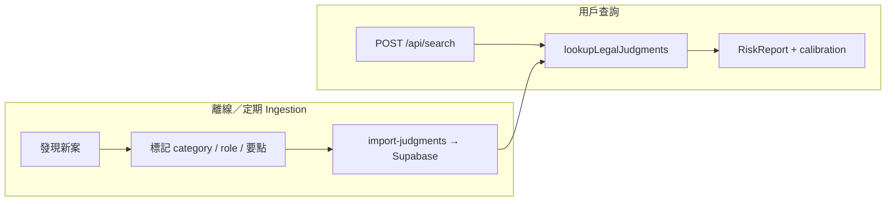

# DEC-0012: Track 1 司法判詞（Renocheck v1.0.0）

- **Status:** proposed（GA v1.0.0 時改 **accepted**；見下 beta scope）
- **Beta scope (owner):** **accepted** 2026-10-16 — [`owner-attestation-track1-beta.md`](../checklists/owner-attestation-track1-beta.md) 確認表 1–5（內測／preview；**唔**等同 v1.0.0 商業 GA 或法律意見）
- **Date:** 2026-10-15
- **Amendment 2026-10-16 (a):** Track 1 **入庫／lookup 僅 MWC 被告**；**原告 pass** — **superseded in part** by (b)  below。
- **Amendment 2026-10-16 (b) — Aaron / 商業 launch 建庫 [accepted]：** 離線索引 **所有公司被告**（裝修委聘相關候選），**唔限 MWC**；MWC／RGBC 名冊匹配改為 **報告內正面信號（enrich）**，唔作入庫 hard gate。**自然人／独资（未審）** → `review`／唔自動 live。**原告** 仍 pass。**Search-time LRS** 仍禁止（離線 only）。執行：[`judgment-topic-crawl-v2-aaron-2026-10-16.md`](../plans/judgment-topic-crawl-v2-aaron-2026-10-16.md)、D2 `company_defendant_v2`。
- **Related:** [`track1-official-extensions-roadmap.md`](../phases/track1-official-extensions-roadmap.md)（v1.1.0 海關、v1.2.0 清盤）、[`track1-v1-0-execution.md`](../plans/track1-v1-0-execution.md)（實作 P0–P7）、[`pipeline-ssot.md`](../design/pipeline-ssot.md)、MVP §2.2 Track 1 延伸、DEC-0011（官方區塊 SSOT 敘事）

## Context

Renocheck 現有 **Track 1** 以 MWC 名冊為主；**Track 2** 靠合規網搜取得公開討論。用戶期望「裝修情報中心」包含 **政府法律紀錄**，但：

- 香港 **沒有**「輸入 BR → 是否被告」的單一政府 API。
- 判詞多為 **已刊憲／法律資料庫** 上的公開文本，需 **匯入或檢索 + 商號對照**，覆蓋範圍必須在產品上誠實標示。
- 將法律事實經 LLM 改寫或與未過濾 Serp 混用，會破壞 SSOT 與合規（不得斷言「黑店」、須可連結來源）。

**產品版本約定（2026-10-15 確認）：** **對外 Renocheck 1.0** = 司法判詞 Track 1 延伸 **GA** 嗰次發布。同步：`package.json` → **1.0.0**、`reportVersion` bump、必要時 `disclaimerVersion`、發布說明／頁尾版本顯示 **1.0**。v1.1.0／v1.2.0 為其後 **minor** 能力（海關、清盤），見 roadmap。

**前置（release gate）：** Track 2 pipeline SSOT 達 [`pipeline-ssot.md`](../design/pipeline-ssot.md)／DEC-0009 gold 約定（或產品 owner 書面豁免）。判詞延伸 **唔** 代替修復 `boundHitCount`／`retrievalEvidence` 缺口。

## Options

| Option | Pros | Cons |
|--------|------|------|
| A — 僅 Serp `site:` 司法域名 | 快、無新表 | 同論壇：bind 錯、漏案、唔適合作法律 SSOT |
| B — 結構化匯入 + search 時 lookup（類 MWC） | 可核對、可測、與官方區塊一致 | 需選源、import job、entity match、法律審閱 |
| C — 全判詞全文長期 mirror | 離線查詢 | 版權／條款／storage；超出 MVP+ 需要 |

## Decision

**Option B（v1.0.0 範圍：司法判詞 only）。**

### 產品行為

1. **I/O 順序：** 判詞 lookup **必須**在 MWC 之後、用與 Serp 相同之 **entity 上下文**（`searchLabelUsed`、normalized BR、MWC 公司名）查 Supabase；可與 **網搜** `Promise.all`（MWC 完成 → 並行 `lookupLegalJudgments` + `fetchWebSearch`）。**僅電話查詢**且 MWC 命中時，須用名冊公司名／BR 做法律對照（判詞庫通常無電話）。唔阻塞 Serp 為目標，唔強求三者在同一 `Promise.all` 起點。
2. **報告呈現（schema 方向）：** 擴展 `official` — 建議 `official.legalEvents[]`（**唔**放入 `signals.retrievalEvidence`；後者保留 DEC-0006 **Track 2 L1** 專用）。實作同步 `report-schema.ts` 與 MVP §5。每條 event：
   - `sourceType: "court_judgment"`（v1.1+ 海關等共用表時靠此區分）
   - 案號、法院、判決／刊憲日期、`matchReasonZh`（短）
   - **`judgmentCategory`**、`partyRole`（見 §3；report 內 echo import 值）
   - **`hearingKeyPointsZh`**：`string[]`（聆訊／判詞**要點**列點，每點字數上限；**import 或人工 seed 寫入**，v1.0 **唔**用 LLM 生成）
   - **`sourceUrl`**（必填）：用戶點擊閱讀原文／官方刊載；**唔**在報告內顯示長摘錄或全文
   - `sourceLabel`（可選，如「司法機構刊憲」）、`registrySnapshotAt`（匯入批次時間）
   - 文案：**「在本次已匯入的公開判詞紀錄中」** — 禁止「從未被起訴」「一定輸官司」等定性。
3. **LLM、分檔與判決類型（v1.0.0，產品 2026-10-15 確認）：**
   - 判詞 **唔**送入 LLM 作口碑推論；`summaryZh`、themes、highlights **不得**因判詞自動寫「黑店」等定性。
   - **有對照到的判詞紀錄 → 應影響風險評估**（業主角度：正常承辦商唔應常現司法紀錄），但 **必須按判決類型同诉讼角色** 用 **deterministic calibration** 處理，唔係「有官司就最高風險」。
   - 每條 `legalEvents[]` 在 **import 時** 必須帶結構化欄位（唔靠 LLM 即時分類）：
     - `judgmentCategory` — 見下文 **Appendix A**
     - `partyRole`：`defendant` | `plaintiff` | `third_party` | `unknown`（相對於本次查證公司）
     - 可選 `outcomeHint`：`judgment_against_defendant` | `dismissed` | `settled` | `unknown`（僅在來源明確時填）
   - **Calibration：** 新增或擴展 `risk-report-calibration-v2`（或 `legal-event-calibration.ts`）在論壇／L1 信號之後套用 **法律紀錄下限（floor）／爭議級別下限**；`riskBandZh` 取 **較嚴重** 者。具體矩陣見 **Appendix B** — **發布 v1.0 前須合規 + grading human sign-off**（同 DEC-0010）。
   - **MWC `licenseStatus`** 不因判詞自動改（名冊仍獨立）；法律信號進 **`evaluation` 新欄或擴展 `reputationTrack`／`legalTrack`**（實作時選一，同步 schema）。
   - UI：除要點 + 連結外，顯示 **判決類型標籤**（用戶可理解「咩類型官司」）及一句 **程式生成** 說明（如「公開紀錄顯示與工程／裝修合約相關之民事程序」），唔用 LLM 臆測案情。
4. **紀錄範圍（產品過濾，2026-10-16 (b)）：** 離線入庫以 **公司被告** 為主（`partyRole=defendant` + D2 `company_defendant_v2`）；**裝修／工程相關信號** 或優先案號前綴；**`matchConfidence=high`** 方自動 `import:judgments`（自然人／独资／弱信號 → review）。**MWC 非必須** — 有則 enrich 及報告「政府名冊有登記」。**原告 pass**（唔 import／唔 lookup／唔升檔）。文案仍 **唔** 暗示「無官司」或全港覆蓋；未登記裝修公司亦可能入庫（用戶查商號時對照 `company_name_normalized`／alias）。
5. **Entity match：**
   - 優先：**BR**（判詞或匯入欄位）、**normalized 公司名**（與 `searchLabelUsed`／MWC 名冊名、既有 L1 括號／NFKC 規則一致）。
   - 同名／弱 match → 唔顯示該條；必要時在 report 層標 `legalMatchAmbiguous: true`（若 schema 加入），**唔**猜。
   - 個人被告與公司查詢：只顯示 **公司為當事方** 或摘錄明確提及該商號之紀錄；唔把個人官司硬 bind 到公司查詢（除非 DEC 後續放寬）。
6. **資料來源（唔預鎖單一網站）：**
   - **選源原則：** 以 **最新、可核對、具官方／司法刊憲性** 為準；實作時在 import metadata 記 `source_catalog_id`、`source_published_at`（或判決日期）。同一 `case_ref` 多個 URL 時，庫內保留 **一條主記錄**，`sourceUrl` 指向運維選定之 **主連結**（較新且較準者）；換源時更新 hash／日期，唔 duplicate 顯示。
   - 允許來源類型包括司法機構刊憲、公開法律索引等；**禁止** 登入制爬取、禁止全文 mirror。
   - DB 存：索引欄位 + **`hearingKeyPointsZh`**（要點）+ `sourceUrl`；**唔**存長摘錄欄位為必需。
   - 首個 import 實作 PR 附 **來源清單表**（名稱、範例 URL、更新頻率、ToS 備註）— 產品唔須事先揀定品牌，但工程須可追溯。

#### DATA.GOV.HK 能否 feed legal DB？

**結論：[Likely] 唔夠做 v1.0 判詞庫主糧；[Certain] 仍係 Track 1 其他線嘅重要開放數據渠道（例如 MWC，見 `docs/sourcedata/README.md`）。**

| 需求 | DATA.GOV.HK | 對 Renocheck |
|------|-------------|--------------|
| **逐案判詞**（公司名／BR、案號、被告／原告、連結） | **無**等同 MWC 嘅「司法判詞」標準數據集；有 **法例現行版本**（律政司 e-Legislation 每週 ZIP），係 **條文** 唔係 **案件** | **唔** 靠 `api.data.gov.hk` 單一 cron 建立 `official_legal_events` |
| **海關（v1.1）** | 有 **案件／檢獲／拘捕統計**（聚合 CSV／API） | 做背景統計可以；**逐公司檢控** 要 **海關公佈／新聞稿** 等另源 import |
| **清盤（v1.2）** | 有 **清盤公司統計數目**、破產署 **罰款統計** 等 | **統計** 唔含可查 entity 之公司名列表；逐公司要 **憲報／破產署清盤紀錄／CR 電子查冊** 等（多 **唔** 在 data.gov 以 PSI 逐案提供） |
| **公司條例檢控** | CR **檢控個案概要** 主要在 [cr.gov.hk](https://www.cr.gov.hk/tc/compliance/prosecution-archive.htm) 網頁 | 可作 **補充源**（人手或審核後 import），唔假設已有完整 data.gov CSV |

**v1.0 建議主源（個案級）：**

1. **香港司法機構 — 法律參考系統／刊憲判詞**（[legalref.judiciary.hk](https://legalref.judiciary.hk/lrs/common/ju/judgment.jsp)、[judiciary.hk 判詞](https://www.judiciary.hk/zh/judgments_legal_reference/judgments.html)）— `sourceUrl` 指向刊憲／司法主連結；可按訴訟方搜尋做 **discovery**（運維／審核，唔係 user search 即時爬）。
2. **公開法律索引**（例如 [HKLII](https://v2.hklii.hk/databases?cat=C) 各級法院／**小額錢債審裁處 HKSCT**、勞資 HKLAT 等）— 作 **索引與連結**；使用條款須在來源清單表記錄，**唔** mirror 全文。
3. **PoC：** 10–20 宗 **人手 seed**（裝修相關案）即可開工，**唔** 阻塞於 data.gov。

**DATA.GOV 仍應用於：** 已上架 PSI（MWC 名冊、日後若有 CR／部門逐案 open CSV）；`api.data.gov.hk/v2/filter` 只 filter **已登記 resource URL**，唔會產生判詞。

**商業使用：** 司法判詞網站註明下載多限 **私人研究**；商業使用或須 **書面申請**。Renocheck 上線前須 **法律確認**「要點 + 連結」模式（同 MWC open data 唔同假設）。

7. **Policy A 不變：** Track 2 Serp hits 仍須 L1 後才入 LLM；判詞 **不** 替代 L1，亦 **不** 把未結構化司法 Serp 結果當 Track 1 紀錄。允許 Serp 作 **發現** 新 case 之運維提示，但 **唔** 自動寫入 Track 1 表（須經 import／人工審核）。
8. **Supabase：** `official_legal_events`（或等價）**RLS on**；anon 不可寫；service role import；讀取僅 server pipeline（同 `mwc_contractors` 模式）。

### 資料獲取流程（實作 — **唔**係用戶搜尋時爬政府網）

用戶 `POST /api/search` **唔會**即時去司法／政府網「代你搜判詞」（慢、唔穩定、易違 ToS、難做 SSOT）。做法同 **MWC 名冊**：**離線匯入 → Supabase → 每次查詢只做 DB lookup**。

| 步驟 | 做咩 | 誰／何時 |
|------|------|----------|
| **1. 發現（Discovery）** | 從 **刊憲判詞、公開法律索引、DATA.GOV 等** 搵與裝修承辦商相關新案；可用 **人手搜政府／司法網**、訂閱更新、或 **內部** Serp `site:` 提示（**唔**自動入庫） | 運維／腳本，週期性 |
| **2. 核對與標記** | 對照 **公司全名／BR**、填 `judgmentCategory`、`partyRole`、`hearingKeyPointsZh`、揀 **最新最準** `sourceUrl` | 人手或半自動（v1.0 **唔**靠 LLM 分類） |
| **3. 匯入** | `pnpm import:judgments`（或 seed JSON）寫入 `official_legal_events`，`source_content_hash` 去重 | CI／本機 + service role |
| **4. 查詢** | Pipeline 用 `searchLabelUsed`／BR 查表；命中則出報告 + Appendix B 升檔 | 每次 search，純 DB |

**PoC：** 步驟 1–2 可以全人手（10–20 宗 JSON）；正式版再自動化 **步驟 1 的「列表抓取」**（仍要步驟 2 審核才入庫）。  
**禁止：** 用戶請求觸發的 live scrape、登入後台、把判詞全文 mirror 入庫。

#### 長遠運維：要唔要 cron？

**[Likely] 要** — 同 `pnpm import:mwc` 刷新名冊一樣，法律紀錄唔會自己入 Supabase。建議分階段：

| 階段 | 做法 |
|------|------|
| **v1.0 GA** | 人手／adhoc 跑 `pnpm import:judgments`；報告標 `legalRegistryAsOf`（最後成功匯入時間） |
| **v1.0+ 穩定後** | **定時 job**（週／雙週）：下載或抓取 **來源清單表** 內之更新（新刊憲案號列表等）→ staging → **審核或規則過濾** → upsert DB。實作選項：**Vercel Cron** 呼叫受保護 Route Handler、**GitHub Actions**、或托管機 `cron` — 皆只跑 **import 腳本**，唔改 `POST /api/search` 架構 |
| **半自動** | 腳本只拉「候選 case manifest」；`judgmentCategory`／要點仍人手或後台確認（v1.0 唔靠 LLM） |
| **監控** | import 失敗告警、來源 404、連續零新增異常；**唔**要求每次 user search 觸發 download |

**唔需要**（YAGNI）：為法律源單獨開 queue/worker 微服務；一個 idempotent import + cron 足夠直至量級觸發 DEC。

**與 `search_cache`：** 法律庫更新 **唔** 自動令舊 fingerprint 失效（同 MWC 更新）；用戶要最新法律區可 `refresh` 或等 cache TTL。報告應顯示法律紀錄 **摘錄截至** 時間。

### 技術骨架（實作指引，非本 DEC 強制表名）

- 新 migration：`official_legal_events`（或等價）— `source_type`, `source_catalog_id`, `case_ref`, `court`, `event_date`, `party_names`, `hearing_key_points_zh`（jsonb `string[]`）, `source_url`, `source_published_at`, `br_normalized`, `company_name_normalized`, `topic_tags`（或 `renovation_relevant` bool）, `imported_at`, `source_content_hash`（去重）。
- `scripts/import-judgments.ts`（或分階段 manual seed JSON → import）。
- Pipeline：`lookupLegalJudgments(supabase, entityContext)` → 填入 report structured 欄位。
- Tests：合成 fixture + **≥1 條真實裝修相關**公開判詞 gold（公司名或 BR 可對照）；eval 不要求 live 法院 API。

### 驗收（v1.0.0 release gate）

- [ ] PoC／seed：**10–20 宗真實**、**裝修委聘相關**公開判詞已入庫並通過 match 抽樣。
- [ ] 有判詞 match 時，報告含 ≥1 條：**聆訊要點列點** + **可點擊 `sourceUrl`**（無長摘錄）；UI 與 API 一致。
- [ ] 無 match 時，明確 **「已檢索匯入紀錄；未見與本次查證對象對照之判詞」**（唔寫「無官司」）。
- [ ] 免責／點樣運作／報告資料來源段落更新（**human review** `/legal/*`）。
- [ ] `pnpm test` + 判詞 lookup／schema 測試；`reportVersion` bump；舊 cache 行為 documented。
- [ ] `pnpm eval:report-quality`（或新增 legal fixture 腳本）覆蓋：有判詞 match、無 match、同名不 bind。
- [ ] 人工 sign-off：法律區文案 + **Appendix B 分檔矩陣**（合規／grading）。
- [ ] fixture：至少一宗 **被告 + 裝修相關民事** → 風險分檔 **不低於** 矩陣約定；一宗 **原告** 或 **unrelated** → 唔誤升最高檔。

## Appendix A — `judgmentCategory`（v1.0 初版，import 標記）

**輔助欄位（與 category 一齊入庫，供 Appendix B 矩陣）：**

| 欄位 | 值 |
|------|-----|
| `partyRole` | `defendant` \| `plaintiff` \| `third_party` \| `unknown` |
| `outcomeHint` | `judgment_against_defendant` \| `dismissed_or_withdrawn` \| `settled` \| `partial_liability` \| `unknown` |
| `procedureStage` | `final_judgment` \| `interlocutory` \| `appeal` \| `hearing_only` \| `unknown` |
| `eventDate` | 判決／刊憲日期（計算是否「舊案」） |

### 類別（與裝修委聘相關度由高到低概略）

| 值 | 含義 |
|----|------|
| `renovation_engineering_civil` | 裝修／室內工程 **合約**、工程質量、延期、完工爭議 |
| `building_defect_water_damage` | 滲水、失修、樓宇／佔用相關 **民事**（常見業主 vs 承辦商） |
| `arbitration_award` | **仲裁** 裁決（裝修合約常見）；視為與工程民事同級處理 |
| `small_claims_debt` | **小額錢債／小額索償** 被告被追款 |
| `general_contract_debt` | 非小額法庭之 **合約欠款**／收款訴訟（被告） |
| `small_works_regulatory` | 小型工程、屋宇署／註冊相關 **監管** 程序 |
| `criminal_regulatory` | 刑事／監管定罪（海關 v1.1 等可共用） |
| `winding_up_insolvency` | 清盤、破產、償債安排（v1.2 清盤源） |
| `employment_labour` | 勞資審裁／僱傭（僱主為被告） |
| `personal_injury_site` | 工傷、工地意外 **民事**（被告為承辦商時） |
| `landlord_tenant` | 租賃（若承辦商為業主／租客一方，與裝修質量關聯較弱） |
| `intellectual_property` | 商標／抄襲等（通常與委聘無關） |
| `defamation` | 誹謗（多數只展示，小心合規用字） |
| `other_civil` | 其他民事 |
| `unknown` | 未能分類 — 只展示，預設唔升檔 |

## Appendix B — Calibration 矩陣（定稿前示意 + sign-off）

**組合邏輯：** 先算 **類別基線（被告）** → 再套用 **Appendix C 修正**（outcome、程序階段、年代、多宗）→ 與論壇／L1 結果取 **較嚴** 之 `riskBandZh`／`disputeLevel`。

### B.1 被告 — 類別基線（`outcomeHint` 非 dismissed 時）

| `judgmentCategory` | `riskBandZh` 下限 | `disputeLevel` 下限 | 備註 |
|--------------------|-------------------|---------------------|------|
| `renovation_engineering_civil` | 風險中等 | `active_concerning` | 核心委聘風險 |
| `building_defect_water_damage` | 風險中等 | `active_concerning` | 同工程糾紛檔 |
| `arbitration_award` | 風險中等 | `active_concerning` | 同 `renovation_engineering_civil` |
| `small_claims_debt` | 風險中等 | `active_concerning` | **高於** 勞資 |
| `general_contract_debt` | 風險中等 | `active_concerning` | 付款能力信號 |
| `small_works_regulatory` | 風險中等 | `active_concerning` | 合規／牌照相關 |
| `criminal_regulatory` | 風險中等 | `active_concerning` | 嚴重案可再加 C 修正升偏高 |
| `winding_up_insolvency` | 風險中等 | `active_concerning` | 公司主體風險；v1.2 與清盤源一致 |
| `personal_injury_site` | 風險中等 | `active_concerning` | 工地安全／管理 |
| `employment_labour` | **中性**（只展示為主） | `historical_isolated` | **唔** 預設升至風險中等 |
| `landlord_tenant` | 中性 | `historical_isolated` | |
| `intellectual_property` / `defamation` | 中性 | `none_detected` | 多數只展示 |
| `other_civil` | 中性 | `historical_isolated` | 介於勞資與合約之間，定稿可調 |
| `unknown` | — | — | 唔改分檔 |

### B.2 原告（公司主動告人）— **2026-10-16 修訂：不納入庫**

| 情況 | 處理 |
|------|------|
| 任何 `plaintiff`（相對於 MWC／查證公司 match） | **唔** `import:judgments`；runtime **唔** 返回 `official.legalEvents`；**唔** 套用本 Appendix 升檔 |
| 歷史 PoC 已入庫之原告行 | D2 重跑或 `purge:legal-events` 後剔除 |

**Superseded（2026-10-15 原文）：** 原告「中性 + 展示、唔升風險偏高」— 僅適用於 **曾考慮展示原告** 之設計；owner 2026-10-16 收窄覆蓋為 **被告 only**（[`judgment-d2-mwc-defendant-scope.md`](../plans/judgment-d2-mwc-defendant-scope.md)）。

### B.3 與 DEC-0010 的例外

`boundHitCount === 0` 時，若仍有 **被告** 且類別 ∈ {`renovation_engineering_civil`, `building_defect_water_damage`, `arbitration_award`, `small_claims_debt`, `general_contract_debt`, `small_works_regulatory`, `criminal_regulatory`, `winding_up_insolvency`, `personal_injury_site`} → **允許** 按 B.1 升檔。  
僅 `employment_labour`／`landlord_tenant`／`unknown` → **唔** 強制升檔。

## Appendix C — 修正因子（疊加在 B.1 之上）

| 條件 | 效果 |
|------|------|
| `outcomeHint === dismissed_or_withdrawn` | **唔** 套用 B.1 升檔；只展示 + 標「程序已撤回／被駁回」 |
| `outcomeHint === settled` | 基線 **降一級**（例如中等 → 仍中性或維持中等，定稿選一） |
| `outcomeHint === judgment_against_defendant` | 用足 B.1；若已有 ≥2 宗有效被告紀錄（5 年內）→ `riskBandZh` 不低於 **風險偏高** |
| `procedureStage === interlocutory` \| `hearing_only` | 基線 **降一級** 或只展示（未作終局裁決） |
| `procedureStage === final_judgment` \| `appeal` | 用足 B.1 |
| `eventDate` 超過 **10 年** | `disputeLevel` 上限 `historical_isolated`；`riskBandZh` **唔** 高於 **風險中等**（舊案唔當近期高風險） |
| 同名歧義 match | 唔顯示、唔升檔 |

## Amendments log

| 日期 | 變更 |
|------|------|
| 2026-10-16 | **原告 pass：** 入庫／lookup／calibration 僅 **被告**；覆蓋目標 = 盡量 MWC 被告案（非 exhaustive） |

## Consequences

- **與 DEC-0010：** 現行「`boundHitCount === 0` ⇒ 一定 `中性`」在 **有被告 + `renovation_engineering_civil` 判詞 match** 時可按 Appendix B **例外升檔**；實作時更新 [`risk-band-grading.md`](../design/risk-band-grading.md) 並在 DEC-0010 加 cross-link amendment（發布 v1.0 前）。
- v1.1.0（海關）、v1.2.0（清盤）**不得** 在 v1.0.0 schema／UX 未穩定前硬塞同一欄位混用 — 見 roadmap 共用 `official_legal_events` 或 `source_type` 擴展。
- 運維：定期 import + 來源失效監控。
- 與 DEC-0006 evidence SSOT：判詞為 **Track 1 structured**；論壇仍為 **Track 2 evidence** — 兩者並列展示，唔互相取代。

## Reversal cost

中 — 需 migration 回滾、cache 失效、移除 UI 區塊與 calibration 分支。

## Triggers to reconsider

- 法律意見要求調整 Appendix A／B 或禁止某類別升檔。
- 可靠開放 API 出現（可簡化 import；`judgmentCategory` 仍須可追溯）。
- 自動 NLP 分類判決類型 — **新 DEC**（v1.0 只用 import 標記）。
