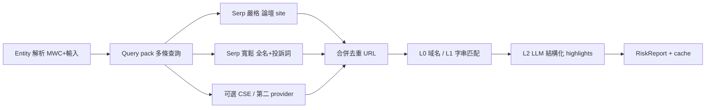

# Search evidence design（Track 2）

> **狀態：** 設計草案（實作前對齊）  
> **目的：** 定義如何透過 Serp／其他途徑取得 **可引用、可核對** 的公開來源，再交 LLM 摘要。  
> **唔係：** 判定「黑店」、永久黑名單、UGC 收錄。

對齊：`docs/MVP.md` §2.2–2.3、`compliance-legal`、V2 `company intelligence`（持久快照另議）。

---

## 1. 問題（現狀）

| 現象 | 根因 |
|------|------|
| `serpHitCount: 20` 但 `discussionCount: 0` | 命中頁多為 **群組總帖／泛化文章**，snippet **未綁定** query entity |
| 深德類查詢出現無關 Facebook 頁 | **單一 query 模板**（引號全名 + `site:` + 風險詞）對 Google 不穩定 |
| 無法穩定試「有負評」case | 缺 **可重現的檢索規格** 與 **人工標註評估集**，只靠感覺調 prompt |

**結論：** 應先設計 **Evidence retrieval（找來源）** 與 **Entity binding（對象）** 分層，再調 LLM 評級。

---

## 2. 「可靠 source data」定義（產品／合規）

對 Renocheck，**可靠** 指 **可稽核的引用鏈**，唔指「內容為真」：

1. **可引用：** 穩定 URL（公開、無登入牆；尊重 provider ToS）。
2. **可對象：** 標題／摘要／正文片段能支持「與本次查詢 entity 相關」的 **推理**（非同名另一間）。
3. **可域：** 與裝修／室內設計／小型工程 **糾紛或交易風險** 相關（剔除美容、搬屋等）。
4. **可呈現：** 可產出 `highlight`（摘要 + `sourceName` + `dateHint` + `url`），文案中性。

**唔納入：** 匿名爆料無 URL、長期存全文帖、HouseHero 式聚合黑名單 **整表 mirror**（可當線索再 Serp 驗證，唔直接當 DB 事實）。

---

## 3. Entity 主鍵（Track 1 對齊）

| 優先 | 輸入 | 檢索用 label | 備註 |
|------|------|----------------|------|
| 1 | Normalized HK 電話 | MWC `company_name` + 電話 | 網搜 **用名冊名**，唔用純電話做 Google q |
| 2 | BR | 名稱 + BR 片段 | |
| 3 | 公司名 | 用戶輸入名；若 MWC hit 則 **以名冊名為準** | 可選：與用戶輸入差異大 → 報告提示 |

Fingerprint／cache 仍跟 MVP；**檢索策略** 跟 `entityLabel` + `aliases[]`（MWC 中英名、登記號）。

---

## 4. 檢索架構（建議）

### 4.1 Query pack（Serp）— 待評估後寫入 DEC

| ID | 模板（示意） | 目的 | 預期 quota |
|----|----------------|------|------------|
| Q1 | `"{{entityLabel}}" (裝修\|室內設計) (投訴\|苦主\|爛尾\|糾紛) (site:lihkg.com OR site:discuss.com.hk OR site:facebook.com)` | 論壇優先 | 1 call / page |
| Q2 | `"{{entityLabel}}" 裝修 (投訴 OR 苦主 OR 爛尾)` **無 site** | 補 Threads／新聞 snippet | 1 call / page |
| Q3 | `{{phone}}` 或 `"{{entityLabel}}" {{phone}}` + 裝修 | 電話出現在帖 | 可選，注意 PII 日誌 |

**現行 code（DEC-0002 + DEC-0003）：** production Q1（引號全名 + site）× `SERP_PAGE_COUNT` + Q2 **loose 短 entity** × `SERP_Q2_PAGES`（預設 2+1 Serp requests），合併 → L1 → LLM；eval **Prod** 欄同 API。

### 4.2 其他途徑（優先序）

| 途徑 | MVP | 備註 |
|------|-----|------|
| **Google CSE** | 第二 provider DEC | 可固定 site collection；與 Serp 二選一或 failover |
| **DATA.GOV / MWC** | 已有 | 官方，非討論 |
| **法院／海關** | Phase 1.5 | 結構化來源，另表 |
| **直接爬 LIHKG／FB** | 不做 | ToS／登入／維護成本 |
| **HouseHero／博客黑名單** | 不做自動 ingest | 僅人工找 case 做評估標籤 |

---

## 5. 分層過濾（code 路徑）

| 層 | 做咩 | Fail 行為 |
|----|------|-----------|
| **L0** | URL host ∈ allowlist（lihkg, discuss, facebook.com, threads.net, 新聞域名清單） | 丟棄 hit |
| **L1** | title/snippet 含 `entityLabel` 子串 **或** normalized phone **或** BR | 丟棄；減少群組「總覽帖」 |
| **L2** | LLM `generateObject` → `highlights[]` + `discussionCount` | **fail closed**（現行：無 heuristic） |
| **L3** | 抽樣人工標註（見 §6） | 調 prompt／query，唔直接改評級表 |

**注意：** L1 太嚴會漏（帖內只寫「呢間」）；L2 負責語意。調參靠 **評估集**，唔靠單一公司試搜。

---

## 6. 評估方法（實作前必做）

### 6.1 固定評估集（10–15 條，合成＋公開案例）

每條記錄：

- `query`（公司名／電話）
- `expectedEntity`（MWC 是否 match）
- `goldUrls[]`（人工確認：至少一條 **相關** 公開 URL；可為空）
- `notes`（同名、已改名等）

**唔寫入產品 UI**；放 `docs/design/search-evidence-fixtures.md` 或 spreadsheet（勿 commit PII）。

### 6.2 指標

| 指標 | 定義 |
|------|------|
| **Recall@URL** | gold URL 是否出現在合併 Serp 結果（任一 query） |
| **Precision@highlight** | LLM 輸出 highlights 中，人工認為相關的比例 |
| **Empty rate** | 有 gold 但 highlights=0 的比例（目標趨近 0） |

### 6.3 通過門檻（建議）

- Recall@URL ≥ **70%** on 有 gold 的 case（MVP 試運）
- 無 gold 的 case 允許 0 highlights（真・零信號）

達標後才 **DEC-0002（待定）** 鎖定 query pack + L1 規則，再改 `web-search.ts`。

---

## 7. 與現有 pipeline 的關係

| 組件 | 現在 | 目標 |
|------|------|------|
| `buildEntitySearchQueries` | Q1+Q2 | 版本化 query pack（DEC） |
| `fetchWebSearchHitsForEntity` | Q1+Q2 順序、Q2 可 partial fail | 同上 |
| `synthesizeRiskReport` | raw `serpHitCount` + L1 hits | 已實作（DEC-0002） |
| `search_cache` | 存完整 report | 可加 `evidenceVersion` 字段（query pack 版本）便於重算 |

**評分基準（A–F）** 仍在 LLM prompt／之後 DEC；**唔應**用 raw hit 數做 grade。

---

## 8. 建議工作順序

1. **本週：** 建評估集 10 條 + 手動記 gold URL（含 1–2 條「南興」類、1 條 MWC+零討論、1 條高信號 LIHKG）。
2. **腳本（dev only）：** `pnpm eval:search-evidence` — 見 [`search-evidence-fixtures.md`](search-evidence-fixtures.md) 與 `scripts/fixtures/search-evidence.json`（7 條；其中 2 條有 gold 公開討論／報道摘要）。
3. **對比 Q1 vs Q1+Q2**，選最小 quota 方案 → 寫 **DEC**。
4. **實作 query pack + L1** → 再跑評估集。
5. **LLM prompt** 微調（highlights 必填欄位已有）。

---

## 9. 未決（需你決）

- 每搜尋 **最多幾次 Serp**：production 已定 **4**（DEC-0002）；加 Q3 需新 DEC。
- 是否 **必須** highlights>0 才允許 D 以下 grade（評分 DEC 一併定）。
- CSE 是否取代 Serp 為 primary（費用／合約）。

---

## 10. 相關文件

- `docs/MVP.md` §2.2–2.3  
- `docs/phases/V2-roadmap.md`（持久 intelligence）  
- `docs/development.md`（env／quota）
