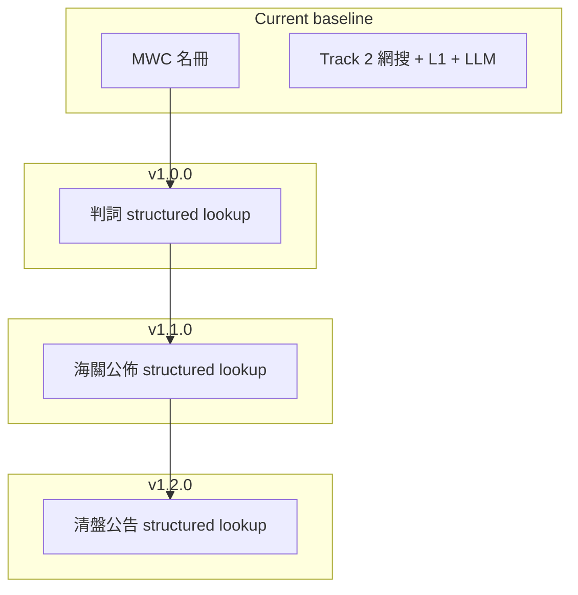

# Track 1 官方延伸 — 產品版本路線圖

**目的：** 在 **pipeline quality OK**（見 [`pipeline-ssot.md`](../design/pipeline-ssot.md) gold／evidence 驗收）之後，把 Renocheck 由「MWC + 公開討論」擴展為 **可核對的政府／法律紀錄索引**。  

**版本號約定（統一）：**

| 對外 | 含義 | 同步 |
|------|------|------|
| **Renocheck 1.0** | 司法判詞 Track 1 GA（DEC-0012） | `package.json` **1.0.0**、`APP_VERSION`、發布文／頁尾 |
| **1.1** | + 海關公佈 | `1.1.0` |
| **1.2** | + 清盤公告 | `1.2.0` |

每次能力 GA：`reportVersion` bump；改免責則 `disclaimerVersion`。

**架構原則（全程）：**

- 單一 `POST /api/search` pipeline；新源 = **平行 lookup + structured report 欄位**，唔開第二條 worker pipeline（除非日後 import 量觸發 DEC）。
- Track 1 紀錄 **唔經 LLM 改寫事實**；評級變更須 **DEC + 合規 sign-off**。
- 用戶文案一律 **「在本次已匯入／已檢索的公開紀錄中」** — 搜不到 ≠ 沒有官司／沒有檢控／沒有清盤。

---

## 總覽

| 版本 | 範圍 | DEC | 依賴 |
|------|------|-----|------|
| **v1.0.0** | 司法判詞（結構化匯入 + lookup） | [DEC-0012](../decision-log/DEC-0012-track1-court-judgments-v1-0-0.md) | Pipeline SSOT gate；schema + import + UI 官方法律區 |
| **v1.1.0** | 海關檢控／相關政府公佈 | DEC-0013（待寫） | v1.0.0 表結構／`source_type` 穩定 |
| **v1.2.0** | 公司清盤公告 | DEC-0014（待寫） | v1.1.0 運維模式（import、監控）成熟 |
| **Phase 4（文件）** | 公司可靠度來源（MWC+承建商名冊、ICRIS 連結、消委會、新聞最後） | 待 DEC | v1.0 判詞穩定；見 DEC-0012 Phase 4、[track1-phase4-company-reliability-sources.md](../plans/track1-phase4-company-reliability-sources.md) |

---

## v1.0.0 — 司法判詞

**一句話：** 查裝修公司時，除 MWC 與論壇摘要外，顯示 **對照到的公開判詞** — **聆訊要點列點 + 來源連結**（用戶自行開原文）；來源揀 **最新、最準** 之官方／刊憲連結，唔預鎖單一網站。

### 交付物

| 類別 | 內容 |
|------|------|
| 資料 | `official_legal_events`（或等價）；PoC manual seed → 定期 import |
| Pipeline | `lookupLegalJudgments` 與 MWC／Serp 並行 |
| API／Schema | `official.legalEvents[]`（**唔**混 `retrievalEvidence`）；`reportVersion` bump |
| UI | 報告「公開判詞紀錄」區：要點 bullets + `sourceUrl`；與 MWC 官方區同 family |
| 對外 | 宣稱 **Renocheck 1.0**（與 `package.json` 1.0.0 一致） |
| 合規 | 更新 `/legal/disclaimer`、報告免責資料來源；禁止「無官司」暗示 |
| 質量 | 單元測試 + gold（含分檔矩陣）；eval／人工 sign-off：**法律區 + DEC-0012 Appendix B** |
| 評級 | 判詞 **按類型／被告角色** 進 deterministic calibration（唔靠 LLM） |
| 範圍 | 只索引 **裝修委聘相關** 判詞（import 標記）；唔做全案由公司訴訟庫 |

### 明確不做（v1.0.0）

- 海關、清盤、勞資 tribunal 全覆蓋
- 進行中案件（未刊憲判詞）
- 以 Serp 司法結果充當 Track 1 SSOT
- 站內 UGC 留言

### 資料怎麼入庫（唔係用戶搜政府網）

離線 **discovery → 人手標記類型／要點 → `import:judgments` → Supabase**；用戶 search 只做 lookup。詳見 DEC-0012「資料獲取流程」。

**長遠：** 需要 **定時 cron**（或 GitHub Actions／Vercel Cron）跑 import 腳本刷新法律庫；v1.0 可人手，穩定後週期匯入 + `legalRegistryAsOf` 顯示於報告。唔在用戶 search 時下載。

**實作步驟（詳）：** [`plans/track1-v1-0-execution.md`](../plans/track1-v1-0-execution.md)（P0–P7、驗收、檔案清單）。

### 建議工程順序

1. Schema + migration + 空 lookup（feature flag）
2. Import／seed **10–20 宗真實、裝修相關**公開判詞（內部驗證 match + 要點文案）
3. Report UI + API 全開（DEC-0004 精神：不藏官方索引）
4. 免責 human review → 發布 **Renocheck 1.0**（`package.json` 1.0.0）

---

## v1.1.0 — 海關檢控／政府公佈

**一句話：** 匯入 **香港海關（及 DEC 列明之同類政府公佈源）** 與裝修／建材／入口相關的檢控或定罪公佈，對照公司名／BR 後在報告展示。

### 範圍草案

- **來源形態：** 新聞稿、公佈 PDF／HTML 列表（非實時 case API）。
- **Schema：** 沿用 v1.0.0 事件表，`source_type = customs_prosecution`（或等價）；欄位：公佈日期、案要、当事方、連結。
- **Match：** 同 v1.0.0 規則；海關公佈常為公司全名 — 仍需 ambiguous 處理。
- **評級：** 預設 **display-only**；是否影響「風險偏高」須 DEC-0013 決定。
- **合規：** 用「政府公佈摘要」語氣；唔寫「走私犯」等標籤式定罪（以公佈原文為準）。

### 前置

- v1.0.0 import job、監控、報告區塊 UX 已上線一個 sprint 以上。
- 撰寫 **DEC-0013**（來源 URL 清單、更新頻率、保留期）。

### 明確不做（v1.1.0）

- 清盤公告（留 v1.2.0）
- 全自動 NLP 從 PDF 抽被告（先 structured 欄位或人工 seed）

---

## v1.2.0 — 清盤公告

**一句話：** 匯入 **公司清盤／ winding-up 相關公開公告**（例如公司註冊處／司法刊憲類來源 — 以 DEC 為準），對照 BR／公司名，在報告標示 **清盤程序相關公開紀錄**。

### 範圍草案

- **與判詞分開敘事：** 清盤 ≠ 民事裝修糾紛；UI 分標籤「清盤／公司程序」與「判詞」。
- **Match：** **BR 優先**（清盤公告常含 BR）；公司曾改名要記錄 `aliases` 或歷史名。
- **評級：** 清盤紀錄可觸發 **保守提示**（例如資料飽和度、checklist 項）但 **須 DEC-0014** 定是否動 `riskBand`；預設傾向 **顯示 + checklist**，唔自動等同「風險偏高」。
- **用戶價值：** 業主委聘前察覺承辦商 **公司主體** 已進入清盤程序（極端但高信號）。

### 前置

- v1.1.0 運維穩定；DEC-0014 完成法律審閱（清盤資料敏感但為公開紀錄）。

---

## 跨版本共用

| 主題 | 做法 |
|------|------|
| Entity SSOT | 與 `searchLabelUsed`、MWC、電話／BR 規則一致 |
| Cache | `reportVersion` miss 舊報告；法律紀錄 `imported_at` 顯示於報告 |
| Eval | 每版增加 gold fixture（有紀錄／無紀錄／同名歧義） |
| Monetization | DEC-0004 下官方索引 **不** 付費牆（除非未來 DEC 改） |

---

## 與 V2 roadmap 關係

[`V2-roadmap.md`](V2-roadmap.md) 的 **Company intelligence**（entity 主檔、snapshot 時間線）可在 **v1.2.0 後** 把 `official_legal_events` 掛到持久 entity — **唔** 阻塞 v1.0.0 以「每次 search lookup」上線。

---

## 待辦（治理）

- [ ] 實作 v1.0.0 前確認 pipeline SSOT gold gate
- [ ] 起草 DEC-0013（海關）、DEC-0014（清盤）— **在 v1.0.0 GA 後、開工 v1.1.0 前**
- [ ] `AGENTS.md`／`MVP.md` §2.2 連結本 roadmap（已連 DEC-0012）
