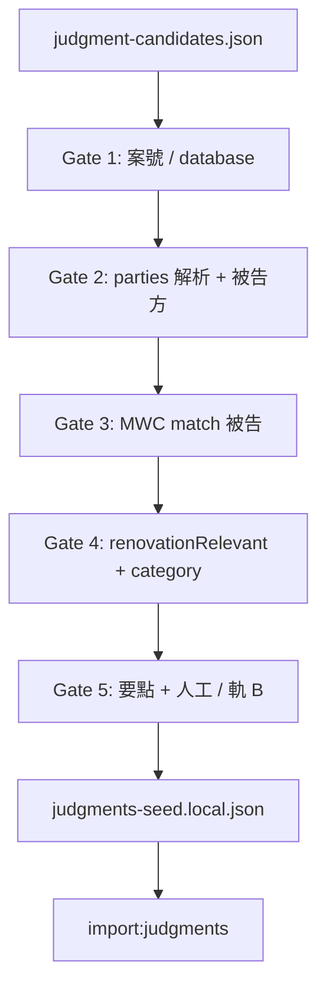

# D2 — 判詞候選清洗與 MWC 被告入庫

**狀態：** active（**D1 gold gate PASS** 2026-10-16 — [`judgment-d1-gate-2026-10-16.md`](./judgment-d1-gate-2026-10-16.md)）  
**上游：** D1 [`judgment-candidates.json`](../../scripts/output/judgment-candidates.json)（gitignore；2026-10-16：**174** `caseRef`）  
**下游：** `judgments-seed.local.json` → `pnpm import:judgments`  
**決策：** DEC-0012 **2026-10-16 amendment** — **僅被告**；原告 pass — [`DEC-0012`](../decision-log/DEC-0012-track1-court-judgments-v1-0-0.md)  
**覆蓋目標：** [`judgment-d2-mwc-defendant-scope.md`](./judgment-d2-mwc-defendant-scope.md)

---

## 1. 目標與非目標

| In | Out |
|----|-----|
| 從 D1 候選產生 **import-ready** 行：`partyRole=defendant` + MWC 可解釋 match | User search 即時爬 LRS |
| `renovationRelevant: true` 且符合案號／類別 gate | 原告入庫或 UI 展示 |
| `hearingKeyPointsZh` + `sourceUrl`（合規要點，唔 mirror 全文） | LLM 自動寫要點（軌 B 要 DEC-0013） |
| 分批擴庫 + smoke | 一次 import 174 宗無人工 gate |

---

## 2. 端到端（D2）

**原則：** Keyword（D1 `discoveredFrom`）**唔**證明公司歸屬；歸屬只在 **F3**。

---

## 3. Gate 1 — 案件殼（deterministic）

來源行：`caseRef`, `eventDate`, `partiesLine`, `database`, `judgmentUrl`, `lrsListingUrl`。

| 規則 | 動作 |
|------|------|
| `database !== Judgments` | **drop** |
| `caseRef` 前綴 ∈ `CACC`, `HCMA`, `DCCC`（`lrs-ingestion-profiles.json` `caseRefSkipPrefixes`） | **drop** |
| 無 `caseRef` 或無 `eventDate` | **drop**（或入 `needs-review` 隊列，預設 drop） |
| 前綴 `HCSA`, `DCCJ`, `LDPD`, `LDBM` | **keep**（優先） |
| `HCA`, `HCPI` | **review**（預設 drop 直至 D2 有要點） |
| 其他 | **review** |

`sourceUrl`：優先 `judgmentUrl`；否則用 `caseRef` 建 LRS `ju_frame` / `lrs:discover-case` 核對（人手或腳本）。

---

## 4. Gate 2 — Parties 與被告方

**輸入：** `partiesLine`（LRS 列表一行，常為「甲 對 乙」或中英混合）。

| 步驟 | 規則 |
|------|------|
| 分割 | 按 ` 對 `、` v `、` VS `（大小寫）拆兩側；拆唔開 → **review** |
| 角色（香港民事習慣） | **左側**多為原告／上訴人；**右側**多為被告／被申索人 — **[Likely]** 小額錢債上訴（HCSA）表頭可能反轉，**必須**用案號 + 表頭「申索人／答辯人」核對 |
| 被告字串 | 取 **被告側** 全段；保留「陳某某經營XXX」整段作 `companyNameNormalized` 候選 |
| 個人 only | 僅人名、無商號、無 MWC match → **drop**（DEC-0012 唔硬 bind 個人官司到公司查詢） |
| `partyRole` | 固定 `defendant`（相對於 match 之 MWC 公司） |

**[Certain]** PoC 不能 100% 自動；HCSA 上訴、多原告被告需 **spot-check 清單**（見 §9）。

---

## 5. Gate 3 — MWC match（被告 only）

對 **被告方字串**（及拆出之商號）查 `mwc_contractors`（離線腳本或 enrich，同 [`judgment-lookup-match.ts`](../../src/lib/judgment-lookup-match.ts) 規則）：

| 優先 | 條件 | 結果 |
|------|------|------|
| 1 | `br_normalized` 與 MWC 一致 | **match** + 記 `brNormalized` |
| 2 | normalize 公司名 = MWC `company_name_normalized` | **match** |
| 3 | `lookupAliases` / 經營名 / `suggestLookupAliasesForLegalRow` | **match**（寫入 seed `lookupAliases`） |
| 4 | 多 MWC hit 或弱 match | **no import**（唔猜） |

**一行 seed = 一個 (caseRef, MWC match, defendant)**。同一案兩個 MWC 被告 → 兩行。

**無 MWC match：** 唔入庫（候選仍留 D1 JSON 供日後加 alias／forward parties 搜）。

---

## 6. Gate 4 — 裝修相關 + 類別

| 欄位 | 規則 |
|------|------|
| `renovationRelevant` | `true` 才 import；`false` / 缺 → lookup 唔返 |
| `judgmentCategory` | DEC-0012 Appendix A；被告工程類優先 `renovation_engineering_civil`, `small_claims_debt`, `general_contract_debt`, `building_defect_water_damage` |
| `outcomeHint` | 僅來源明確時填；唔確定 `unknown` |
| **原告** | 若判定為 `plaintiff` → **drop**（DEC amendment） |

**Heuristic（自動建議 + 人工確認）：** `partiesLine` 或要點含 裝修|工程|承建|翻新|滲水|室內|小型工程 → 建議 `renovationRelevant: true`；純勞資、租賃、誹謗 → 預設 `false`。

---

## 7. Gate 5 — 要點與合規

| 項 | 要求 |
|----|------|
| `hearingKeyPointsZh` | ≥1 條；每條 ≤120 字；**唔**用黑店／騙子；事實性短句 |
| 來源 | 軌 A：人手讀 LRS 要點／表頭；軌 B：`draft-judgments-from-candidates`（**DEC-0013**）+ 人工改 |
| `companyNameNormalized` | 必須 = 被告側且與 MWC match 用名一致 |
| `partyRole` | 必須 `defendant` |

---

## 8. 產物與命令（現行 / 待建）

| 步驟 | 命令 / 腳本 | 狀態 |
|------|-------------|------|
| 合併候選 | `pnpm build:judgment-candidates` | ✅ |
| MWC enrich seed | `pnpm enrich:judgments-seed --write` | ✅（seed 存在時） |
| **候選 → defendant 草稿** | `pnpm d2:filter-candidates` → `judgment-d2-queue.json` / `judgment-d2-keep.json` | ✅ |
| 驗證 seed | `pnpm validate:judgments-seed` | ✅ |
| 入庫 | `pnpm import:judgments --file=…` | ✅ |
| Smoke | `pnpm judgment:poc-smoke` / `legal:lookup-smoke` | ✅ |

**建議 offline 中間檔：** `scripts/output/judgment-d2-queue.json`（`keep` | `drop` | `review` + reason）。

---

## 9. 批次與驗收

| 批次 | 內容 | 驗收 |
|------|------|------|
| **B0** | 清理現有 seed：剔除原告（4 宗）— **Done** 2026-10-16 → **11** 被告行；`validate:judgments-seed` 拒 `plaintiff` | poc-smoke 仍 hit 被告案 |
| **B1** | `pnpm d2:prep` → `pnpm d2:import-keep`（自動 keep → seed + import） | **B1 首批完成** 2026-10-16：seed **14** 被告行；`judgment:poc-smoke` **14/14 lookup**；假 BR（MWC 登記號）已清 |
| **B2+** | 每批 20–50，直至候選清空或 review 隊列穩定 | recall vs gold defendant 清單 |

**Gold：** 現有 seed 被告案 + spot-check 清單；[`judgment-d1-spot-check-2026-10-16.md`](./judgment-d1-spot-check-2026-10-16.md) 中 **相關** 且被告者優先。

---

## 10. 與 runtime 對齊

- `lookupLegalJudgments`：只返 `renovation_relevant` + 名／BR match；**被告行** `partyRole=defendant` echo 到 report。
- `legal-event-calibration.ts`：僅處理 **被告** 事件（原告行不應再存在於 DB）。
- UI：維持「在本次已匯入的公開判詞紀錄中」；**唔**寫「所有官司」。

---

## 11. 待決（owner / 工程）

1. HCSA 上訴表頭 **被告側** 自動規則 — 要 5–10 宗 labeled fixture。  
2. 無 MWC match 嘅被告案 — 只留 D1 候選，定唔做 forward parties（J5）。  
3. `lookupLegalJudgments` **80 行 limit** — 入庫 >80 被告行前要 DEC／index。

---

## Changelog

| 日期 | 備註 |
|------|------|
| 2026-10-16 | 初稿；DEC-0012 原告 pass |
| 2026-10-16 | `pnpm d2:filter-candidates` — 174 入 → see `judgment-d2-queue.json` summary |
