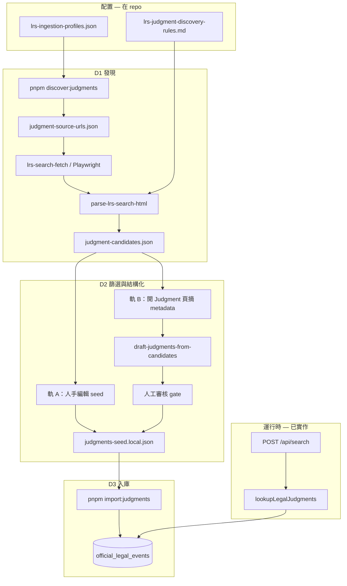

# Track 1 判詞 — 來源獲取與 DB 入庫執行計劃

**狀態：** draft（v1.0 GA 前執行藍圖）  
**North star：** `official_legal_events` 足夠支撐 `lookupLegalJudgments` + 報告 `official.legalEvents`（DEC-0012）；**user `POST /api/search` 唔即時爬 LRS**。

**邊界：** 本計劃只覆蓋 **離線 ingestion（D0–D3）**。產品 runtime（pipeline、ReportCard、`LEGAL_EVENTS_ENABLED` 等）見 [track1-v1-0-execution.md](./track1-v1-0-execution.md) — 該文檔 P2+ 多數已實作，**唔**與建庫混為一談。

**相關：**

| 文檔 | 角色 |
|------|------|
| [DEC-0012](../decision-log/DEC-0012-track1-court-judgments-v1-0-0.md) | 產品／schema／合規決策 |
| [track1-v1-0-execution.md](./track1-v1-0-execution.md) | 產品 P0–P7（pipeline、UI、migration） |
| [lrs-judgment-discovery-rules.md](../design/lrs-judgment-discovery-rules.md) | LRS URL／關鍵字／結果頁 parse 規則 |
| [judgments-sources.md](../sourcedata/judgments-sources.md) | 來源清單與 ToS |
| [report-quality-human-signoff.md](../checklists/report-quality-human-signoff.md) | 發布前 smoke／grading 簽核 |
| [SERP-RESERVED-FOR-USERS.md](../../scripts/ingestion/SERP-RESERVED-FOR-USERS.md) | 判詞建庫唔用 Serp |

**概要三階（保留舊稱）：** [judgment-bulk-ingestion-discovery.md](./judgment-bulk-ingestion-discovery.md) — 本文件為其 **執行細節 SSOT**。

---

## 1. 範圍

### In scope（本計劃）

- 離線 **發現** → **候選** → **審核／標記** → **`pnpm import:judgments`** → Supabase
- 主源：**legalref.judiciary.hk（LRS）**；HKLII 僅交叉核對
- PoC：**10–20 宗真實案**入庫；D1 候選池 **≥50** 去重 `caseRef`（以 Tier A 為主，見 §4 D1）

### Out of scope

- User search 即時抓判詞、Serp `site:` 建庫、cron／queue（MVP 後再 DEC）
- 判詞全文 mirror、登入後爬取
- data.gov.hk 作逐案判詞主源（見 DEC-0012）

---

## 2. 端到端流程

**D2 兩軌（PoC 用 A 即可）：**

| 軌 | 路徑 | 何時用 |
|----|------|--------|
| **A — 人手** | `candidates` → 人手編輯 → `judgments-seed.local.json` | **J3 / PoC**；唔使 DEC-0013 |
| **B — LLM 草稿** | `candidates` → `judgments-draft.json` → 人工 gate → seed | J4；要 DEC-0013 |



---

## 3. 產物與路徑

| 產物 | 路徑 | Git |
|------|------|-----|
| 查詢 profile | `scripts/config/lrs-ingestion-profiles.json` | ✅ |
| 案號→法院（最小表） | `scripts/config/court-from-case-ref.json` | ✅（J1 起） |
| URL 清單 | `scripts/output/judgment-source-urls.json` | ❌ gitignore |
| 候選案（metadata） | `scripts/output/judgment-candidates.json` | ❌ |
| LLM 草稿（可選） | `scripts/output/judgments-draft.json` | ❌ |
| **入庫 JSON** | `scripts/fixtures/judgments-seed.local.json` | ❌ `.gitignore` 已包含 |
| 合成示例 | `scripts/fixtures/judgments-seed.json` | ✅ |
| URL 格式示例 | `scripts/fixtures/judgment-source-urls.example.json` | ✅ |

### Idempotency 與去重（[Certain] 現行 schema）

- `import-judgments` 用 `upsert(..., { onConflict: "source_content_hash" })`。
- `source_content_hash` 由 `caseRef`、`sourceUrl`、`eventDate`、`companyNameNormalized`、`judgmentCategory` 等組合 hash（見 `scripts/import-judgments.ts`）。
- 表上 **只有** `source_content_hash` UNIQUE；**冇** `case_ref` UNIQUE。

**含義：**

- 修正 `sourceUrl` 或 `companyNameNormalized` 再 import → **新 hash → 新 row**；舊 row 仍留 DB。
- Runtime `lookupLegalJudgments` 按 `case_ref` 去重展示，**唔**會自動刪舊 row。

**PoC 運維：** 改同一案前，人手刪舊 row 或接受暫時重複；v1.0 後可 DEC：`unique(case_ref)` 或「按 case_ref upsert」。

---

## 4. 階段執行細節

### D0 — 環境與合規（一次性）

| # | 動作 | Done 標準 |
|---|------|-----------|
| D0.1 | Supabase migration + `pnpm import:judgments` 打 synthetic seed | `pnpm legal:lookup-smoke` 命中**合成**示例公司 |
| D0.2 | 記錄來源表 [`judgments-sources.md`](../sourcedata/judgments-sources.md) | 每源有範例 URL、ToS 備註 |
| D0.3 | **法律確認**「要點列點 + `sourceUrl`」商業使用（司法條款） | 書面／ticket 連結寫入 sourcedata 或 DEC |
| D0.4 | **DEC-0013**（僅 **D2 軌 B** 自動 LLM draft） | proposed → accepted 後才跑 `draft-judgments-from-candidates` |

### D1 — 發現候選（工程）

**已有：**

```bash
pnpm discover:judgments
pnpm discover:judgments --open-hints
```

- Builder：`src/lib/lrs-search-url.ts`（**JU only**、`txtselectopt` 1/3）
- 規則：`docs/design/lrs-judgment-discovery-rules.md`

**待建（建議順序）：**

| 腳本 | 職責 | 輸入 → 輸出 |
|------|------|-------------|
| `scripts/parse-lrs-search-html.ts` | 解析結果頁：caseRef、date、parties、database、judgment link | HTML → row[] |
| `scripts/lrs-search-fetch.ts` | Playwright 開 URL；分页至 `maxPagesDefault`；限速（e.g. 1 req / 1.5s） | URLs → HTML |
| `scripts/build-judgment-candidates.ts` | 合併多 profile、去重、Zod 驗證、寫 manifest | → `judgment-candidates.json` |

**候選 manifest：** 頂層加 `schemaVersion`；row 欄位見下。J1 應附 Zod schema（或 `scripts/lib/judgment-candidates-schema.ts`）。

```json
{
  "schemaVersion": 1,
  "caseRef": "HCSA64/2017",
  "eventDate": "2017-06-01",
  "partiesLine": "甲 對 乙",
  "neutralCitation": "[2017] HKSC 123",
  "database": "Judgments",
  "lrsListingUrl": "https://legalref.judiciary.hk/lrs/common/search/search_result.jsp?...",
  "judgmentUrl": "https://legalref.judiciary.hk/...",
  "discoveredFrom": { "profileId": "phrase-裝修工程", "tier": "A" },
  "fetchedAt": "2026-10-16T12:00:00.000Z"
}
```

**D1 候選池 ≥50 條規則：** 先跑完 **Tier A** profiles 合併去重；若不足 50，再補 **Tier B**；**Tier C（`裝修`）只計 cap 內頁數**，唔為凑數全爬。

**D1 第二軸（Phase 1.5 / J5）：** LRS **Parties** 欄 — form POST 或 Playwright 填表 GO（case-number GET 曾 500）。

**D1 全量 crawl：** [`judgment-d1-full-crawl.md`](./judgment-d1-full-crawl.md) — 2026-10-16 本機 **174** `caseRef`（[`judgment-d1-crawl-run-2026-10-16.md`](./judgment-d1-crawl-run-2026-10-16.md)）。

**D2 覆蓋目標（owner）：** 盡量 **MWC 被告**；**原告 pass** — [`judgment-d2-mwc-defendant-scope.md`](./judgment-d2-mwc-defendant-scope.md)。**清洗 SSOT：** [`judgment-d2-cleaning.md`](./judgment-d2-cleaning.md)。

**D1 Done：**

- [x] Tier A（必要）+ 按需 Tier B，去重 **≥50** `caseRef` — **59** 條（2026-10-16；`pnpm d1:tier-a` → `judgment-candidates.json`）
- [x] 人手 spot-check **≥10** 條確認與裝修／工程糾紛相關（記錄 precision 比例） — [`judgment-d1-spot-check-2026-10-16.md`](judgment-d1-spot-check-2026-10-16.md)（24 條；相關 12/24，HCSA+DCCJ 約 86%）
- [ ] 每候選有可點擊 `judgmentUrl` 或 caseRef 可核對

### D2 — 篩選與 import-ready 行（產品 + 合規）

**輸入：** `judgment-candidates.json` +（軌 B 可選）`judgmentUrl` 表頭文字（**唔**存全文入 repo）。

**規則層（deterministic，先於 LLM）：**

1. `database === "Judgments"`；跳過 Practice Directions
2. 案號前綴：優先 `HCSA`、`DCCJ`、`LDPD`、`LDBM`；`HCA`/`HCPI` 降權；跳過 `CACC`、`HCMA`、**`DCCC`（刑事）**
3. `observedHits` > 500 的 profile 不得未經 D2 全量入庫

**結構化欄位（對齊 `import-judgments` SeedRow）：**

| 欄位 | 來源 |
|------|------|
| `caseRef`, `eventDate`, `sourceUrl` | D1 + 核對 LRS 主鏈 |
| `court` | `scripts/config/court-from-case-ref.json`（J1 起最小表；J5 擴充） |
| `companyNameNormalized` | 從 parties 揀 **承辦商一方**（v1.0：多為**被告**；與 owner 查承辦商情境一致）；唔確定則唔入庫 |
| `brNormalized` | 可選；可從 MWC enrich，唔阻塞 PoC |
| `judgmentCategory`, `partyRole`, `outcomeHint` | DEC-0012 Appendix A/B；**import 時必填** |
| `hearingKeyPointsZh[]` | 軌 A 全人工；軌 B LLM 草稿 + **人工改**；每點 ≤ 建議 120 字 |
| `renovationRelevant` | `true` 才會被 lookup |
| `sourceCatalogId` | e.g. `legalref-lrs-ju` |

**軌 B 待建（YAGNI：PoC 可唔做）：**

- `scripts/draft-judgments-from-candidates.ts` → `judgments-draft.json`
- 審核後人手合併入 seed（**唔**必須獨立 `merge-judgments-draft.ts`）

**人工 gate（必須，真實案）：**

- [x] 合規用詞（見 `compliance-legal`）；要點無指控性標籤 — Agent 預審 **15/15**（2026-10-16；[`judgment-seed-human-signoff-2026-10-16.md`](../checklists/judgment-seed-human-signoff-2026-10-16.md)）
- [ ] **Grading：** DEC-0012 Appendix B + [report-quality-human-signoff.md](../checklists/report-quality-human-signoff.md)（判詞相關項）— 預審抽樣 Pass [Likely]；**真人 UI sign-off 仍 open**
- [x] `companyNameNormalized` 與 parties 一致 — 預審 **15/15**（同上）

**D2 Done：**

- [x] `judgments-seed.local.json` **≥5** 條 `renovationRelevant: true`（真實案，非 synthetic） — **15** 條（2026-10-16）
- [x] 每條有 ≥1 條 `hearingKeyPointsZh` — 同上（人工 gate／合規 sign-off 仍見上文 checklist）

### D3 — 入庫與驗證

```bash
pnpm import:judgments --dry-run --file=scripts/fixtures/judgments-seed.local.json
pnpm import:judgments --file=scripts/fixtures/judgments-seed.local.json
```

**兩層驗證（唔混為一談）：**

| 層 | 命令 | 證明咩 |
|----|------|--------|
| **Pipeline** | `pnpm legal:lookup-smoke`（合成公司／BR） | DB + lookup 路徑通 |
| **真實 seed** | 對每條入庫案：`pnpm legal:lookup-smoke "<companyNameNormalized>"` 及有 BR 時 `--br …` | 該行可被 user 查證命中 |
| **報告（建議）** | `pnpm judgment:poc-smoke --api-base=…` 或 `POST /api/search`（讀 **`body.report`**） | `report.official.legalEvents` + calibration |

**D3 Done：**

- [x] DB row 數與 import 一致；RLS：anon 不可 write — **17** rows（15 local + 2 synthetic `judgments-seed.json`）；anon `select` 0 行、`insert` **42501**（2026-10-16）
- [x] **Pipeline smoke**（合成）通過 — `pnpm legal:lookup-smoke`（2026-10-16）
- [x] **≥5 條真實 seed** 各自 lookup smoke（或等價 full search）命中 — **15/15** lookup + **3/3** API（`pnpm judgment:poc-smoke --api-base=http://localhost:3000`，2026-10-16；輸出 `scripts/output/judgment-poc-smoke-2026-10-16.json`）

---

## 5. 與 runtime lookup 的對齊

`lookupLegalJudgments`（已實作）：

1. **BR** → `br_normalized` 精確 match
2. **公司名** → `company_name_normalized` ilike + normalize 收窄

**建庫含義：** 每行 **`companyNameNormalized`** 必須對應你想俾 user 搜到嘅商號；D1 keyword **唔**產生該欄 — D2 從 parties **指定一方**。

---

## 6. PoC / v1.0 驗收

| # | 標準 |
|---|------|
| 1 | D1：≥50 去重候選（Tier A 為主）；≥10 條確認裝修相關 |
| 2 | D3：≥5 條真實案 import；**每條**真實 lookup smoke（或 full search）命中 |
| 3 | `pnpm legal:lookup-smoke`（合成）仍通過 — 回歸 pipeline |
| 4 | Track 2 Serp 用量不因建庫上升 |
| 5 | 報告含匯入範圍說明 + 可開 `sourceUrl`（產品 checklist 見 track1 / human signoff） |

---

## 7. 建議實作順序（PR 切分）

| PR | 內容 | 依賴 | 狀態 |
|----|------|------|------|
| **J1** | `parse-lrs-search-html.ts` + fixture HTML 單測 + **`court-from-case-ref.json`（最小 prefix）** + candidates Zod | — | ✅ |
| **J2** | `lrs-search-fetch.ts` + `build-judgment-candidates.ts`；`pnpm discover` → `fetch` → `build` | J1 | ✅（fixture 一條龍 + 單測）；**live LRS** 須本機 Playwright（CI／無頭環境可能 timeout／500） |
| **J3** | 5–10 條人手 `judgments-seed.local.json`（**軌 A**，無 LLM）+ `pnpm validate:judgments-seed --min-renovation=5` + 真實 lookup smoke | D0；**唔**依賴 J2 | ✅ **15 條** seed + import（2026-10-16；含 HCSA 59/2014 case-number 發現） |
| **J4** | DEC-0013 + `draft-judgments-from-candidates.ts`（軌 B） | J2、法律 | 🔲 |
| **J5** | Parties 搜尋軸 + 擴充 `court-from-case-ref.json` | J2 | 🔲 |

**YAGNI：** 未跑完 J1–J3 前唔加 cron、第二數據源 adapter。

**J3 與 J2 可並行：** 人手 seed 可從瀏覽器開 Tier A URL 抄 case，唔等 Playwright。

---

## 8. 運維備註

- **更新頻率：** MVP 手動重跑 D1→D3
- **換源／改欄位：** 可能產生新 `source_content_hash` row；必要時人手清理舊 row（見 §3）
- **Raw HTML：** 可存 `scripts/output/lrs-html/`（gitignore），方便 re-parse
- **日志：** fetch 記 `profileId`、page、HTTP 狀態
- **單 profile 試跑：** `pnpm fetch:judgments --profile-id=phrase-裝修工程 --max-pages=1`（避免 Tier A 全量連續 timeout）
- **無法連 LRS：** 可用手動存 HTML 到 `scripts/output/lrs-html/` + 編 `lrs-fetch-manifest.json`，再 `pnpm build:judgment-candidates`
- **秘密：** 僅 service role 用於 import；候選 JSON 避免長期 PII

---

## 9. 檢查清單（發布 v1.0 前）

**Ingestion（本計劃）：**

- [ ] D0–D3 Done（含真實案 lookup smoke）
- [ ] `judgments-sources.md` ToS／法律確認狀態

**產品（[track1-v1-0-execution.md](./track1-v1-0-execution.md)）：**

- [ ] P1–P7 與 DEC-0012 產品行為

**簽核：**

- [ ] DEC-0012 → accepted
- [ ] [report-quality-human-signoff.md](../checklists/report-quality-human-signoff.md)（含 `legal:lookup-smoke`、必要時 full search）
