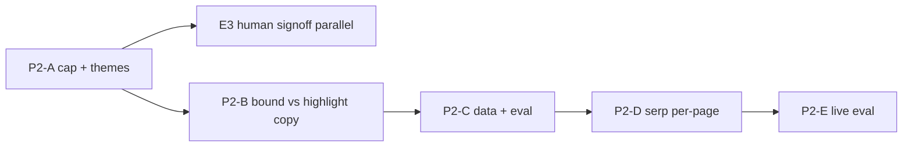

# Pipeline 可信 Phase 2 優化計劃

- **狀態：** P2-A/C/D/E 已實作（E：`report-quality-live.json`、`--live`、[`report-quality-human-signoff.md`](../checklists/report-quality-human-signoff.md)）；C2 暫不改 query  
- **North star（產品）：** Phase 2 ≠ SSOT 達標 — 見 [`pipeline-ssot.md`](../design/pipeline-ssot.md)
- **日期：** 2026-10-13
- **前置：** [`DEC-0004-trustworthy-report-open-access.md`](../decision-log/DEC-0004-trustworthy-report-open-access.md)

## 1. v2 實跑評估（`refresh: true`，本地 dev）

| Case | 結果 | reportVersion | serp / bound | highlights | grade / conf | MWC |
|------|------|---------------|--------------|------------|--------------|-----|
| 良心裝修顧問有限公司 | OK（P2-A 後） | 2.0.0 | 26 / 1 | 0 | **C** / low | 未匹配 |
| 源始（國際）… | OK | 2.0.0 | 19 / 0 | 0 | C / low | 未匹配 |
| 虛構評估公司 | OK | 2.0.0 | 27 / 0 | 0 | **C** / low（原 LLM A 被压） | 未匹配 |
| 輝煌設計工程有限公司 | OK | 2.0.0 | 29 / 0 | 0 | C / low | **匹配** |

_P2-A 前見 git history；良心 themes 已清空、bound-only summary 已套用。_

`pnpm eval:report-quality`（golden）：通過（結構契約，唔代表 live 質量）。

### 對 v1「成功定義」的判定

| 目標 | 達成？ | 說明 |
|------|--------|------|
| **(1) 查緊邊個對象** | **部分** | 欄位齊；樣本多為 `user_only`（名冊未 hit 或 DB 無行），**未驗證**電話→名冊名 |
| **(2) 憑咩下結論** | **部分** | `boundHitCount` + checklist 有；dispute 仍少 highlights；良心 `bound=1` / `highlights=0` |
| **(3) 唔肯定時唔放大** | **未達** | 虛構/良心 **D 級零摘要**；`themes` 與 bound 矛盾（見 §2） |
| **產品參考價值** | **未達** | 透明 OK，情報仍常空殼（政策 A 下可接受，但產品目標未達） |

**結論：v1 工程 ≈ 完成；產品目標 ≈ 未完成。** Phase 2 聚焦 **後處理一致、評級唔誤導、retrieval/MWC 可驗收** — 唔再加 schema/UI 欄位。

---

## 2. Phase 2 目標（可驗收）

### 2.1 證據一致（**後處理為主**，唔逼 LLM 幻覺）

政策 A 下 **唔** 用「送更多 raw hit 入 LLM」補 highlight。

| 情況 | 要求 |
|------|------|
| `boundHitCount > 0` 且 `highlights.length === 0` | **唔** 依賴 LLM 重試逼 highlight；用 **B2** 後處理：`confidence=low`、`discussionCount=0`、summary/UI 說明「已確認 N 條來源字串相關，但未能形成可引用摘要」 |
| `themes` | 當 `boundHitCount > 0` **或** `llmHitCount > 0`（送 LLM 條數）時，**不得** 含「未檢出相關討論」（現行 code 僅在 `highlights>0` 剝，需修 — §3 A2） |
| `serpHitCount > 0` 且 `boundHitCount === 0` | UI 沿用 v1 文案矩陣（未能確認相關） |

### 2.2 評級保守（**必須人工 sign-off**，`compliance-legal`）

規則只 **降級、唔升級**；摘要仍中性，唔加定性字眼。

| 條件 | Grade 上限 |
|------|------------|
| `highlights.length === 0`（**全案**，含 MWC 匹配 + 輝煌類） | **C** |
| `boundHitCount === 0` 且 `serpHitCount > 0` | **C** |
| 允許 **D–F**（下一輪可再收窄） | 僅當 `highlights.length >= 2` **且** themes 含糾紛相關詞（超支/爛尾/糾紛/投訴等）— Phase 2 可先實作 cap，D–F 條件寫入測試與 DEC 附錄 |

虛構、零 bound、零 highlight → **C + low**（唔用 D 嚇人）。

### 2.3 其他目標

3. **Retrieval KPI（內部）：** weekly `eval:search-evidence` Prod **≥1/2** mustInclude（連兩周）；記 gold URL 趨勢 — **唔**作對外準確率承諾。
4. **Serp 韌性：** 現行已有 Q2 fail→留 Q1、page **fetch 單次 retry**（v1）。缺口係 **Q1 多頁其一失敗拖死整包**（良心 `serp_failed`）— 見 §3 D1（可能需 DEC）。
5. **MWC smoke：** 文檔一條 **真實名冊電話**（import 後），驗 `searchLabelUsed === 名冊名`。

仍 **唔做：** L0→LLM、付費牆、CSE（除非新 DEC）。

---

## 3. 工作包（建議順序）

### P2-A — 報告後處理（第一 PR，鎖範圍）

| 項 | 檔案 | 內容 |
|----|------|------|
| A1 Grade cap | `risk-report-calibration.ts` + **新** `calibrateRiskReport(...)` 或在 pipeline 第二段 | 輸入須含 `serpHitCount`、`boundHitCount`（`calibrateLlmRiskSlice` 今日只有 `llmHitCount`，唔夠判 raw>0 bound=0） |
| A2 Theme | 同上 | `boundHitCount > 0 \|\| llmHitCount > 0` → 剝「未檢出相關討論」；`highlights===0` 時若 LLM 留咗亦剝 |
| A3 Prompt | `prompts/risk-report.ts` | 有 `webHits` 時應盡量 highlight；**無則 grade≤C**（輔助，唔取代 cap） |
| A4 UI | `ReportCard.tsx` | 確認 `bound>0 && highlights===0` 走第三行文案 |

**第一 PR 唔包含：** B3、C2、D1 行為改動、prompt 以外 LLM 重試。

**驗收：** 4 條 smoke（§1）重跑；虛構/源始/輝煌 **grade≤C**；良心 **themes** 唔與 bound 矛盾。

**合規：** 合併前 **人工 sign-off** grading 規則（截圖/簽名記於 PR 或 DEC-0004 修訂附錄）。

### P2-B — bound 有、highlight 無（良心類）

| 項 | 內容 |
|----|------|
| B1 | `llm_ok` 已有 `llm_hits`；加 `highlights_len` |
| B2 | `webHits.length>0` 且 `highlights.length===0`：合規 summary 句 + `confidence=low`（與 §2.1 一致） |
| B3 | **僅** B1+log 證實「snippet 有糾紛內容但 L1 token 唔 match」→ DEC-0003 級 token；唔擴表 |

### P2-C — Retrieval + 名冊數據

| 項 | 內容 |
|----|------|
| C0 | **先查數據：** `mwc_contractors` 是否存在良心/源始登記名（SQL 或 Supabase）；`mwc:false` 可能係 **未 import** 而非 lookup bug |
| C1 | weekly eval 記錄表 → `docs/development.md` |
| C2 | 括號 normalize 只改 **query**（`looseEntityCoreTerms`）— eval 前後對照；**唔**鬆 L1 |
| C3 | 僅 C0 證實「DB 有、ilike 唔中」→ normalize 登記名 lookup（小改） |

### P2-D — Serp 韌性（唔只文檔）

| 項 | 內容 |
|----|------|------|
| D1 | `fetchSerpOrganicHits`：**逐頁** try/catch；單頁 fail 保留其他頁；log `serp_partial`（`pages_ok` / `pages_failed`）。若改變「任一页 fail 即 throw」行為 → **短 DEC** |
| D2 | 前端/API：`serp_failed` vs `llm_failed` 文案區分（已有 error code 可接） |

### P2-E — 量度（與 M1 並行）

| 項 | 內容 |
|----|------|
| E1 | `report-quality-golden.json` + `report-quality-live.json`（maxGrade、minChecklist） |
| E2 | `eval:report-quality --live` 實作讀 live fixture |
| E3 | **發布前人工 10 條**（entity、grade、摘要中性）— **唔等** Serp/D；M1 後即可開始填表 |

---

## 4. 里程碑

| 里程碑 | 產品意義 |
|--------|----------|
| M1（A + sign-off） | 零摘要唔再 D–F 嚇人 |
| M2（A+B） | 數字、themes、summary、UI 一致 |
| M3（C0–C3 + E3） | 知係數據定 retrieval；人工 gate |
| M4（D） | 減 `serp_failed` 整單 503 |

---

## 5. 唔納入 Phase 2（除非新 DEC）

- 未過 L1 → LLM（政策 A）
- 第四條 production Serp / 電話 Q3（DEC-0005）
- 付費牆
- 靠 prompt 重試「逼」highlight（避免幻覺）

---

## 6. 立即下一步（1 PR）

1. 實作 **P2-A1 + A2**（擴 calibration 簽名含 serp/bound）
2. 單測：虛構、MWC+bound0、bound1+highlight0
3. **Grading 人工 sign-off**
4. 重跑 §1 四條 smoke，**更新 §1 表**於 PR 描述

完成後再決定 B3 / C2 / D1 是否食 Serp quota。
