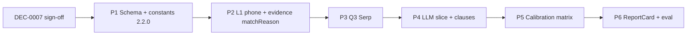

# Pipeline v2.2.0 — 實用落地計劃（雙軌評分 + 電話錨點）

- **狀態：** ready for implementation（DEC-0007 accepted；合規 grading 文案仍需 launch sign-off）
- **日期：** 2026-10-14
- **基線：** `reportVersion` **2.1.0**（`retrievalEvidence`、L1 phone/源始 heuristics、M2 highlight ⊆ URL）
- **North star：** [`pipeline-ssot.md`](../design/pipeline-ssot.md) — 報告仍為單一 SSOT；政策 A 不變

---

## 0. 目標與非目標

### 要解決（2.1.0 痛點）

| 痛點 | v2.2.0 方向 |
|------|----------------|
| 零討論 + 有名冊 → 仍顯示 **C**，用戶以為「中等風險」 | **合規軌**與**口碑軌**分開 + `dataSaturation` 語意化 |
| 換殼公司、同一電話 | **Q3 phone-first Serp** + L1 **phone_anchor** |
| 靜態 checklist 與個案無關 | **actionableClauses**（LLM 生成 + 校準；**P4 可選**，見 §7） |
| highlight 無時效 | `approxYear` / `incidentType` 結構化 |

### 非目標（本計劃不包）

- L0 → LLM、第二條 pipeline、付費牆  
- 法院／海關自動化（`licenseStatus: expired` 需 MWC 欄位或新數據源 — 見 §1.3）  
- 對外承諾「準確率 %」（仍用內部 eval）

---

## 1. 決策門檻（必須先過）

### 1.1 DEC-0007（建議標題：Dual-track evaluation & v2.2.0 schema）

**必寫內容：**

- `reportVersion: 2.2.0` + cache miss 策略（同 DEC-0004/0006）
- **雙軌與 API 相容**：頂層 **`grade` / `confidence` 必須與 `evaluation.overallGrade` / `evaluation.confidence` 同步**（mirror，單一裁定來源 = calibration v2）；新增 `evaluation.*`；UI「B+」用 **`evaluation.displayGradeZh`**（DEC-0007 默認採納，見 §10）
- **合規軌 B 級零糾紛**：文案必須「未檢出公開糾紛」而非「安全／無風險」 — **compliance-legal 人工 sign-off**
- **Q3 Serp**：第四類 production 查詢（quota +1 頁/次）；**Serp 關鍵詞唔用「黑店」**（與 `renocheck-product` 一致；糾紛詞見 §3.1）
- **PII**：`entity.normalizedPhone` 僅當用戶輸入電話時寫入；唔重複 log 全號
- **Supersede：** DEC-0004 **Appendix A**（Phase 2 一律壓 C）由本計劃 §5 矩陣取代；DEC-0007 Appendix 記新規則

### 1.2 與現行 DEC 關係

| DEC | v2.2.0 影響 |
|-----|-------------|
| DEC-0004 | 全量開放；`actionableClauses` 同 checklist 一併開放；**Appendix A grading 由 DEC-0007 取代** |
| DEC-0005 | Q3 屬新 production Serp — **需 DEC-0007 明確授權** |
| DEC-0006 | `retrievalEvidence` 保留；擴展 `matchType: phone_anchor` 在 evidence row |
| DEC-0003 | Q2 邏輯保留；Q3 在 **有 normalizedPhone** 時啟用（§10 默認：含電話嘅任何查詢） |

### 1.3 數據可行性（已核實 2026-10-14）

- [x] `mwc_contractors` 現有欄位：`company_name`, `phone`, `registration_no`, `source_updated_at`（**無**級別、**無**到期）— 見 `supabase/migrations/20261012202625_initial_mvp_schema.sql`
- [x] **v2.2.0 MVP：** `licenseStatus` 僅 `active | not_found | ambiguous`（`mwcMatched` + 非 ambiguous → `active`）；`registrationClass`、`expired` **延後**（需 import 新欄或 DEC）
- [x] **保留 `entity`**，唔改名 `target`；`nameAlignment` 維持現行 enum（`match` / `mwc_authoritative` / `user_only` / `ambiguous`），雙軌文案由 `evaluation.complianceTrack` 表達

---

## 2. 一、Schema 升級（`reportVersion: 2.2.0`）

### 2.1 建議形狀（與 repo 對齊，非照搬 `types/report.ts` 路徑）

**原則：** 在 `src/lib/report-schema.ts` 演進；`docs/MVP.md` §5 同步；**不刪** 2.1.0 欄位直至前端遷移完成（可並存一個版本）。

```typescript
// 新增（示意；實作以 Zod 為準）
evaluation: {
  overallGrade: gradeSchema,           // 仍 A–F；B+ 等見 displayGradeZh
  displayGradeZh?: string,             // 例：「B+」「C-」— 僅展示，非第二套 enum
  confidence: confidenceSchema,
  dataSaturation: z.enum(["rich", "moderate", "sparse", "unindexed"]),
  complianceTrack: {
    isMwcRegistered: boolean,
    registrationClass?: string,        // 有數據才填
    licenseStatus: z.enum(["active", "not_found", "ambiguous"]), // expired: V2.1+ when DB has dates
  },
  reputationTrack: {
    disputeLevel: z.enum([
      "none_detected", "historical_isolated", "active_concerning", "severe",
    ]),
    recentDisputeCount: number,        // 2 年內；由 calibration 從 highlight.approxYear 計
  },
},
// retrievalEvidence：可升級為頂層或保留 signals；建議保留 signals 並 alias，減 diff
signals.retrievalEvidence[].matchReason: z.enum(["entity_token", "phone_anchor"]),
signals.actionableClauses: z.array({ category, clauseText, reason }).max(8),
// highlights 擴展（向後相容）
discussionHighlightSchema.extend({
  incidentType?: enum,
  approxYear?: string,
  factSummary?: string,  // 或逐步取代 summaryZh
}),
```

**`fingerprint`：** 繼續由 API `SearchPipelineResult` 返回；可選 **冗餘** 寫入 report 方便 SSOT 單檔匯出（DEC-0007 決定）。

**`entity` vs `target`：** **保留 `entity`**，可選 `normalizedPhone?: string`；`searchLabelUsed` = resolved 登記/搜尋名。

**API mirror（必做）：**

```text
report.grade === report.evaluation.overallGrade
report.confidence === report.evaluation.confidence
```

校準函數一次寫入兩處；Zod 可加 `.refine` 防漂移。

### 2.2 遷移

| 步驟 | 內容 |
|------|------|
| S1 | `REPORT_VERSION = "2.2.0"`；cache 2.1.0 miss |
| S2 | `report-quality-golden.json` + live fixture 新增 `evaluation.dataSaturation` 斷言 |
| S3 | `eval:report-quality` 校驗雙軌與 saturation，唔只 `maxGrade` |

---

## 3. 二、Step B & C — Q3 + L1 Phone Anchor

### 3.1 Step B — Q3（Phone-First）

**觸發條件（計劃默認，§10）：** `normalizeSearchInput` 後存在 **8 位 HK `phone`** 即跑 Q3（可同時有公司名）。**僅公司名、無電話** → **唔跑 Q3**（換殼留電話場景需用戶提供電話或日後 BR 鏈路）。

**查詢（合規用詞僅限 Serp，唔入 LLM 摘要）：**

```text
"{normalizedPhone}" ("裝修" OR "工程" OR "室內設計" OR "師傅") ("爛尾" OR "超支" OR "苦主" OR "投訴" OR "拖工" OR "糾紛")
```

- **唔** 使用「黑店」等產品禁語作 Serp 關鍵詞（DEC-0007 與 §3.1 一致）  
- **1 頁**（10 條）；`fetchWebSearchHitsForEntity` 內第三段 try/catch；log `serp_query_failed` `query_index: 3`  
- **Quota：** 有 phone 時最多 **+1** Serp（例：Q1×2 + Q2×1 + Q3×1 = 4，與現 cap 一致）

**實作檔：** `src/lib/web-search.ts`（`buildPhoneAnchorQuery`、`serpQ3PageCount()`）、`fetchWebSearchHitsForEntity` 合併去重。

### 3.2 Step C — L1 擴展

**檔案：** `src/lib/search-evidence-filter.ts`

| 規則 | 行為 |
|------|------|
| Entity token hit | 現行邏輯 + `entityL1MustIncludeAny`（源始等） |
| Phone anchor | `normalizedPhone` 出現在 title/snippet/url（normalize 空格/連字號） |
| 合併 | OR；dedupe by URL |
| SSOT | `buildRetrievalEvidence` 填 `matchReason: "phone_anchor" \| "entity_token"` |

**政策 A：** Q3 結果仍須過 L1（電話 OR token）；**唔**整包 raw Q3 送 LLM。

### 3.3 驗收

- Fixture：[`development.md`](../development.md) 電話 `92805455` — 名冊 + 可選 Q3 增量 bound（有公開帖含電話時）  
- `pnpm tsx scripts/diagnose-retrieval-case.ts` 支援 `--phone`  
- `eval:search-evidence` 新增 **phone** case（合成或文檔化真實測試號，唔 commit PII）

---

## 4. 三、Step D — LLM Structured Prompt

### 4.1 範圍

- **模型：** 仍單次 `generateObject`（`llm-risk-report.ts`）  
- **輸入：** 僅 `webHitsForLlm`（含 phone_anchor 行）  
- **新增 slice 欄位：** `disputeLevel`、`recentDisputeCount`、`highlights[]`（`incidentType`、`approxYear`、`factSummary`）、`customClauses[]`  
- **Prompt：** 繁中 HK、禁止定性字眼；`url` 必須來自輸入；`approxYear` 無則 `unknown`

### 4.2 Pipeline 順序（單一裁定鏈）

```text
L1 webHitsForLlm
  → LLM raw slice（disputeLevel / highlights / customClauses 等為「建議」，唔作最終 grade）
  → enforceHighlightEvidenceAlignment（M2：URL ⊆ L1）
  → calibrateEvaluation v2（產出 evaluation + mirror grade/confidence + summaryZh 模板）
  → buildRetrievalEvidence（matchReason）
  → riskReportSchema.parse
```

- **唔** 再單獨跑 Phase 2 `calibrateLlmRiskSlice` 與 v2 並存；由 v2 **整個取代**（DEC-0007）  
- `factSummary` / `summaryZh` / `clauseText` 長度 cap

### 4.3 測試

- 單測：mock object 含非法 url → 被剔  
- Golden：一條含 `customClauses`、一條空陣列仍保留靜態 `contractChecklist`

---

## 5. 四、Step E — Calibration 矩陣（取代「一律壓 C」）

### 5.1 新模組

- **檔案：** `src/lib/risk-report-calibration-v2.ts`（或擴展現 `risk-report-calibration.ts`）  
- **函數：** `calibrateEvaluation({ mwcMatch, licenseStatus, boundCount, highlights, retrievalEvidence })` → `evaluation` + `grade` + `summaryZh` 模板

### 5.2 與你提供矩陣的對齊（實作版）

| 條件 | overallGrade (A–F) | displayGradeZh | confidence | dataSaturation | disputeLevel |
|------|-------------------|----------------|------------|----------------|--------------|
| MWC active + bound=0 + hl=0 | **B** | B+（展示） | medium | sparse | none_detected |
| 無 MWC + bound=0 + hl=0 | **C** | C | low | unindexed | none_detected |
| bound≥1 + hl=0 | **C** | C+（展示） | low | moderate | none_detected |
| hl=1 且全為 >2 年前 | **C** | C | medium | moderate | historical_isolated |
| hl=1 且 **近期**（≤2 年，`approxYear` 可解析） | **C** | C | medium | moderate | active_concerning |
| hl=2 且近期、糾紛 incident | **D** | D | high | rich | active_concerning |
| hl≥3 或 severe incident 組合 | **E–F** | 依表 | high | rich | severe |

**展示 [Certain]：** `gradeSchema` 僅 A–F；**DEC-0007 默認**用 `evaluation.displayGradeZh` 顯示 B+ / C+（`overallGrade` 仍為 B 或 C）。

**D–F 門檻：** 保留 Phase 2 精神 — **至少 2 則 verified highlights** + 糾紛 `incidentType` / themes；唔靠單帖升 F。

**`recentDisputeCount`：** 由 `approxYear` 解析（未知年份唔計入近期）。

### 5.3 合規文案（與矩陣同步）

| dataSaturation | UI 標籤（繁中，示例） |
|----------------|----------------------|
| sparse + MWC | 官方名冊有登記；本次未檢出公開糾紛討論 |
| unindexed | 名冊未匹配；公開資料不足以評估口碑 |
| moderate | 檢出相關來源；未形成多宗糾紛摘要 |
| rich | 多宗可引用討論；請逐條核實來源 |

**Human review：** 更新 [`report-quality-human-signoff.md`](../checklists/report-quality-human-signoff.md) + DEC-0007 Appendix（grading 變更）。

### 5.4 移除／取代行為

- **取代** DEC-0004 Appendix A：「`highlights.length === 0` → 一律 grade C」改為 §5.2 矩陣（MWC+無討論可 **B** + `sparse`）  
- **保留** Phase 2：零證據唔用「無風險」語；D–F 仍要 verified highlights 門檻（`pipeline-ssot`）  
- **更新** [`pipeline-ssot.md`](../design/pipeline-ssot.md) §「唔肯定時」：低資料用 `dataSaturation` + 雙軌，唔再寫「一律 C」

---

## 6. 五、前端 `ReportCard`

### 6.1 三 Badge（示例結構）

1. **官方資質** — 來自 `evaluation.complianceTrack` + MWC details  
2. **民間聲量** — `reputationTrack.disputeLevel` + `recentDisputeCount`  
3. **綜合** — `displayGradeZh` 或 `grade` + `confidence` 中文

唔使用 emoji 若 [`ui-principles.md`](../ui-principles.md) 禁止；可用文字 Badge。  
**sparse + MWC：** 唔用「綠色／安全」視覺；民間聲量 Badge 在 `none_detected` 時寫「未檢出活躍投訴紀錄」，唔寫「無風險」。

### 6.2 區塊順序

1. 本次查證範圍（保留）  
2. 三 Badge  
3. 摘要 `summaryZh`  
4. **簽約防守建議** — `actionableClauses`（非空時優先）  
5. 檢索層 `retrievalEvidence`（標示 phone_anchor / entity_token）  
6. 討論摘要 `highlights`（含 incidentType / 年份）  
7. 靜態 `contractChecklist`（兜底）

### 6.3 低 `dataSaturation`

- `unindexed` / `sparse` 顯示醒目但 **非驚嚇式** caution（延續 low confidence 條）

---

## 7. 實施順序（建議 PR 切分）



| PR | 內容 | 可獨立驗收 |
|----|------|------------|
| **P1** | Zod + `REPORT_VERSION` + 空 `evaluation` 默認值 | `pnpm test` schema |
| **P2** | L1 phone anchor + `matchReason` | 單測 + diagnose ✅ |
| **P3** | Q3 Serp | `eval:search-evidence` / diagnose ✅ |
| **P4** | LLM schema + prompt（`approxYear` / `incidentType`；`customClauses` → `actionableClauses`） | golden parse ✅ |
| **P5** | Calibration v2（**依賴 P4 slice 形狀**） | 矩陣表單測 ✅ |
| **P6** | UI + live eval + 可選啟用 `actionableClauses` 渲染 | `--live` 見 §9.1（UI ✅） |

**可選切片 2.2.0-alpha：** P1 + P5（僅 `dataSaturation` + mirror grade，LLM slice 仍舊）+ P6 Badge — **唔** 建議跳過 P2/P3 若目標包含電話錨點。

**Agent 執行：** 每 PR 按 [`agent-execution`](../.cursor/rules/agent-execution.mdc) 跑 test/lint/build/live（如適用）。

---

## 8. 風險與取捨

| 風險 | 緩解 |
|------|------|
| MWC + B 被讀成「保證唔會爛尾」 | 文案 + `sparse` + medium confidence + 民間 Badge 中性；**禁止**「合規=安全」配色 |
| 僅公司名查詢、無 Q3 | 產品文案提示「提供電話可提高討論檢索覆蓋」 |
| Live eval 與 2.1.0 假設衝突 | §9.1 逐條更新 `maxGrade` / `dataSaturation` |
| Q3 增加 noise | L1 phone 必須全串 8 位；可選 host 白名單不加嚴 |
| LLM `customClauses` 法律建議口吻 | Prompt 用「簽約前可與對方確認」；唔稱法律意見 |
| Schema 膨脹 | `evaluation` 一層收斂；避免重複 `official` 與 `complianceTrack` 長期雙份 — P1 後標 `@deprecated` 路線 |

---

## 9. 完成定義（v2.2.0「實用落地」）

- [x] DEC-0007 ACCEPTED + grading 人工 sign-off（文案／Badge 仍待 launch）  
- [x] `reportVersion 2.2.0`（P1）；2.1.0 cache miss  
- [ ] 電話 smoke：`evaluation` 雙軌 + Q3 已啟用（有 Serp 增量或文檔記錄「無電話帖」）  
- [ ] `pnpm eval:report-quality --live` 更新斷言（§9.1；MWC grade B 已寫入 live fixture）  
- [x] `pipeline-ssot.md` 雙軌／v2 校準（§5.2 原則）；`MVP.md` §5 可跟進  
- [ ] E3 人工表補充雙軌 Badge 審閱列  

### 9.1 Live fixture 預期調整（2.2.0）

| Case | 2.1.0 習慣 | 2.2.0 斷言重點 |
|------|------------|----------------|
| 輝煌（公司/電話）、偉景 | `maxGrade: C` | MWC + bound=0 → `dataSaturation: sparse`，`overallGrade` 可 **B**，`confidence` medium |
| 良心、源始 | `maxGrade: C` | bound≥1 → `moderate`；grade 仍 ≤C 若無 verified 糾紛 highlight |
| 虛構 | `maxGrade: C` | `unindexed`，grade **C**，low |
| 深德 | bound 可能 >0 | `moderate` + evidence；grade 依 highlight 矩陣 |

---

## 10. 產品決策（計劃默認 — DEC-0007 可覆寫）

| # | 決策 | 默認 |
|---|------|------|
| 1 | Q3 觸發 | **有 8 位電話即跑**（可並行公司名） |
| 2 | B+ / C+ | **`displayGradeZh` + overallGrade A–F** |
| 3 | Schema 命名 | **保留 `entity`** |
| 4 | MWC 級別/到期 | **v2.2.0 不做**；`licenseStatus` 三值 + `registration_no` 展示 |

四項已寫入 **DEC-0007 Appendix B**（Status: ACCEPTED）。

---

**下一步（工程）：** 開 **P1**（schema `2.2.0` + `evaluation` 骨架）— 見 [`DEC-0007-dual-track-v2-2-0.md`](../decision-log/DEC-0007-dual-track-v2-2-0.md)。
