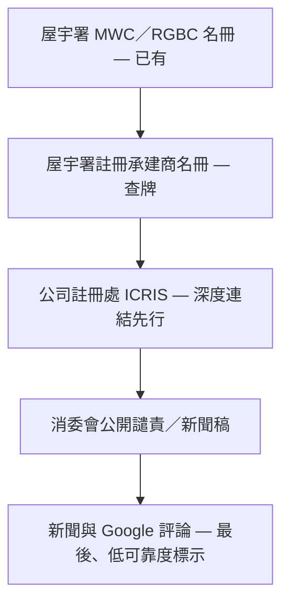

# Track 1 Phase 4 — 公司可靠度來源（文件 only）

**狀態：** 規劃；**唔**阻塞 v1.0 判詞 GA。**唔**含實作 PR（除非新 DEC）。

**相關：** [DEC-0012 Phase 4](../decision-log/DEC-0012-track1-court-judgments-v1-0-0.md#phase-4--公司可靠度來源)、[track1-official-extensions-roadmap.md](../phases/track1-official-extensions-roadmap.md)

## 產品定位

Renocheck Track 1 延伸係 **「官方紀錄查核」** — 協助業主對照 **政府或司法公開來源** 嘅可核對紀錄（名冊、判詞索引、合規公佈等），**唔**係對承建商嘅綜合評分或口碑榜。

| 要講清楚 | 唔做 |
|----------|------|
| 本次查詢對照到嘅公開紀錄摘要 + 連結 | 「可靠／唔可靠」嘅單一總分 |
| 各來源有獨立標籤與局限說明 | 暗示「冇紀錄 = 一定可靠」 |
| **冇紀錄唔代表一定可靠**（覆蓋有限、延遲、未入庫） | 黑店／騙子等指控性標籤 |

UI／報告 copy 須與 [compliance-legal](../../.cursor/rules/compliance-legal.mdc)、[renocheck-product](../../.cursor/rules/renocheck-product.mdc) 一致。

## 來源優先序（建議）

### 1. 屋宇署註冊承建商名冊

- **用途：** 查有冇牌、牌照類別；與現有 **MWC 名冊** 並用（名冊登記 ≠ 所有註冊承建商欄位已覆蓋）。
- **模式：** [Likely] 開放數據或 PSI 與 MWC 類似 — 待來源清單表確認後 structured import；v1.0 可先沿用 MWC lookup + 文案說明局限。

### 2. 公司註冊處 ICRIS

- **現況：** 公司名查冊、文件索引等 **免費查閱** 常見；**條款** 多寫明未得處長 **書面同意**，不得將資料用於 **轉售產品** 或超出許可用途。
- **Phase 4a（建議第一步）：** 報告內只放 **深度連結**（公司名／BR 預填查冊入口），由用戶 **自行查閱**；唔自動拉取或展示 CR 文件內容。
- **Phase 4b（之後）：** 向處長 **正式申請書面同意**；批咗先做自動化查冊／索引 import。申請須 **聲明用途**、符合 **《個人資料（私隱）條例》**（PDPO）及 CR 使用條款 — **須法律／合規 sign-off**，新 DEC 再寫實作。

### 3. 消委會

- **內容：** 點名 **公開譴責**、相關 **新聞稿**（裝修／承辦商相關）。
- **特點：** 量少，但逐單較準；適合人手或半自動 manifest + 審核入庫（同判詞 D2 思路）。
- **合規：** 引用公佈原文連結；唔改寫為指控性標籤。

### 4. 新聞與 Google 評論（最後）

- **優先級最低**；與 Track 2 論壇／Serp 重疊風險高。
- 若產品展示：**必須** 標明 **可靠度較低**、非政府紀錄；**唔** 混入 Track 1 `official` SSOT 區塊。
- 不取代 L1／DEC-0006 對 Serp 嘅政策。

## 與現有 Track 1 判詞（Phase 1–2）關係

- 判詞庫仍係 **司法刊憲／離線 import**；Phase 4 **唔**改判詞 pipeline。
- Phase 4 擴展 `official` 或並列區塊時，須 **分 `sourceType`**、獨立 calibration／展示規則 — **新 DEC**（類似 DEC-0013 海關）。

## 驗收（實作階段再開）

- [ ] 每源來源清單表（URL、ToS、更新頻率、是否可商業自動化）
- [ ] UI：官方查核 vs 低可靠度來源分區
- [ ] 免責：冇紀錄 ≠ 可靠；覆蓋範圍與 `legalRegistryAsOf`／名冊更新日
- [ ] ICRIS：未獲書面同意前 **零** server-side CR 內容 cache

## Amendments

| 日期 | 變更 |
|------|------|
| 2026-10-17 | 初稿：Aaron／產品 — Phase 4 文件 only |
