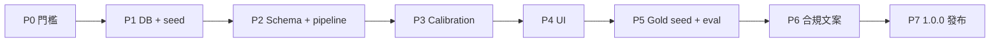

# Track 1 v1.0（Renocheck 1.0）— 執行計劃

- **狀態：** ready for implementation（DEC-0012 proposed；本計劃為實作 SSOT；實作中若與 DEC 衝突以 DEC 為準）
- **日期：** 2026-10-16
- **基線：** `reportVersion` **2.3.1**（`src/lib/constants.ts`）；`package.json` **0.1.x** → GA 時 **1.0.0**
- **North star：** [`pipeline-ssot.md`](../design/pipeline-ssot.md) + [`DEC-0012`](../decision-log/DEC-0012-track1-court-judgments-v1-0-0.md)
- **路線圖：** [`track1-official-extensions-roadmap.md`](../phases/track1-official-extensions-roadmap.md)（v1.1 海關、v1.2 清盤 **唔** 在本計劃）

---

## 0. 完成定義（Done = Renocheck 1.0 GA）

用戶 `POST /api/search` 在 **有匯入判詞 match** 時，報告同時具備：

1. **`official.legalEvents[]`** — 聆訊要點、`judgmentCategory` 標籤、`partyRole`、`sourceUrl`（無長摘錄）
2. **`official.legalRegistryAsOf`** — 法律庫摘錄截至時間（全局一個，唔放每條 event）
3. **Deterministic 分檔** — 按 DEC-0012 Appendix B/C；判詞 **唔** 入 LLM 輸入
4. **10–20 宗** 真實裝修相關 seed 可重現 gold match
5. `/legal/disclaimer`、點樣運作、報告資料來源 **human review** 完成
6. `pnpm test` / `pnpm lint` / `pnpm build`；**現有** `pnpm eval:report-quality` **仍通過**（法律線唔取代 DEC-0009 blocking gold）；另加 **legal 專用 vitest**（mock DB／fixture，唔使 Serp）
7. 無 legal match 時報告含 DEC-0012 驗收句（唔寫「無官司」）
8. `package.json` **1.0.0**、DEC-0012 status → **accepted**

**非目標（v1.0）：** DATA.GOV 判詞主源、cron 自動化、海關／清盤、LLM 分類判決、第二 pipeline。

---

## 1. 前置門檻（P0）

| # | 檢查 | 做法 | 可豁免？ |
|---|------|------|----------|
| G1 | Track 2 SSOT | `pnpm eval:report-quality`；發版前 `pnpm eval:report-quality --live --gate`（見 [`release-gold-set.md`](../design/release-gold-set.md)） | 產品 owner 書面豁免（DEC-0012）；**法律功能唔替代** gold dispute |
| G2 | 分支 | `feat/track1-v1-0-*` off `main`（文檔可先合 `docs/dec-0012-legal-data-sources`） | — |
| G3 | 法律／ToS | 記錄司法「私人研究 vs 商業」確認路徑（DEC-0012 DATA.GOV 小節） | GA 前必須有結論（唔阻塞 P1 schema） |
| G4 | 分檔矩陣 sign-off | DEC-0012 Appendix B/C 定稿一版（含 `small_claims_debt` > `employment_labour`） | GA 前必須 |

```bash
pnpm test && pnpm lint
pnpm eval:report-quality          # 有 key 時可加 --live
```

---

## 2. 階段總覽



| 階段 | 交付 | 驗證 |
|------|------|------|
| **P1** | `official_legal_events` migration、RLS、`scripts/fixtures/judgments-seed.json` | `pnpm db:push`；import dry-run |
| **P2** | `report-schema` `official.legalEvents`；`lookup-legal-judgments.ts`；`search-pipeline` 接入 | 單元測試；mock supabase fixture |
| **P3** | `legal-event-calibration.ts` 接 `risk-report-calibration-v2` | 矩陣 table-driven tests |
| **P4** | `ReportCard` 公開判詞區；`legalRegistryAsOf` | 手動 smoke `/report/[fp]` |
| **P5** | 10–20 **真實**案入庫；`legal-event-calibration.test.ts` + 可選 `report-quality` mock case | dev 搜到 `legalEvents` + 預期 `riskBandZh` |
| **P6** | `/legal/disclaimer`、`how-it-works`、DEC-0010 cross-link | 合規簽核 |
| **P7** | `REPORT_VERSION` bump、`package.json` 1.0.0、DEC accepted | release checklist |

---

## 3. P1 — 資料庫與 seed 格式

### 3.1 Migration（示意）

`supabase/migrations/YYYYMMDDHHMMSS_official_legal_events.sql`

- 表：`official_legal_events`（欄位見 DEC-0012）
- 索引：`br_normalized`、`company_name_normalized`（trigram 或 normalized 欄位 — 跟 MWC 策略）
- **RLS：** 同 `search_cache` — **唔**開 anon/authenticated policy；僅 **service_role** import + pipeline 讀（`mwc_contractors` 係公開名冊可 anon read；法律表 **唔**需要 client 直讀）
- DB 欄位與 import 對齊 DEC-0012：`judgment_category`、`party_role`、`outcome_hint`、`procedure_stage`、`match_reason_zh`（lookup 時填）、`renovation_relevant`／`topic_tags`

### 3.2 Seed JSON（人手 PoC）

- `scripts/fixtures/judgments-seed.json` — **CI／單測用合成案**（可 commit）
- `scripts/fixtures/judgments-seed.local.json`（gitignore）或 **private ops** — **10–20 真實案**（唔 commit 未授權內容）
- `docs/sourcedata/judgments-sources.md` — 來源清單表（URL、更新頻率、ToS 備註）；唔鎖死單一域名

每條最少：

```json
{
  "sourceType": "court_judgment",
  "sourceCatalogId": "judiciary-lrs",
  "caseRef": "DCCJ 1234/2020",
  "court": "District Court",
  "eventDate": "2021-03-15",
  "partyNames": ["示例裝修有限公司"],
  "brNormalized": "12345678",
  "companyNameNormalized": "示例裝修有限公司",
  "judgmentCategory": "renovation_engineering_civil",
  "partyRole": "defendant",
  "outcomeHint": "judgment_against_defendant",
  "procedureStage": "final_judgment",
  "hearingKeyPointsZh": ["要點一", "要點二"],
  "sourceUrl": "https://legalref.judiciary.hk/...",
  "renovationRelevant": true
}
```

### 3.3 腳本

- `scripts/import-judgments.ts` — upsert by `source_content_hash`
- `package.json` → `"import:judgments": "tsx scripts/import-judgments.ts"`
- `docs/supabase.md` — 加 import 說明

**P1 Done：** 空庫 + 2 條 synthetic fixture import 成功；RLS 手動確認 anon 唔可寫。

---

## 4. P2 — Schema 與 pipeline

### 4.1 `report-schema.ts`

- `official.legalEvents[]` — Zod 子 schema（`judgmentCategory` enum 對齊 DEC-0012 Appendix A）
- `official.legalRegistryAsOf?: string`（datetime）
- **`REPORT_VERSION` bump**（建議 **2.4.0** — 含 `official.legalEvents`；與 **app 1.0.0** 分開編號但 **同一 GA PR** 發布）
- 每條 `legalEvents[]` 含：`matchReasonZh`、`judgmentCategory`、`partyRole`、`hearingKeyPointsZh`、`sourceUrl`、`caseRef`、`court`、`eventDate`（echo import；UI 用）
- **`evaluation.legalTrack`（可選 v1.0）：** `{ matchedCount, strongestCategory? }` 僅展示／debug；**分檔仍以 `riskBandZh` floor 為準**（DEC-0012）

### 4.2 Lookup

- `src/lib/lookup-legal-judgments.ts` — 輸入 `entityContext`（`searchLabelUsed`, BR, MWC 公司名）
- 返回 `LegalEvent[]` + `registryAsOf`（max `imported_at` 或常數表 `legal_source_meta` — YAGNI 先用 max imported_at）

### 4.3 `search-pipeline.ts`（與現有 `runSearchPipeline` 對齊）

現行順序：`MWC` → `Serp` → `synthesizeRiskReport` → `enforceHighlightEvidenceAlignment` → `buildRetrievalEvidence` → **`calibrateEvaluation`**（`search-pipeline.ts` ~L219）。

**v1.0 插入點：**

1. `lookupMwcWithMeta` 完成後 → `Promise.all([ lookupLegalJudgments(supabase, ctx), fetchWebSearch... ])`
2. **`synthesizeRiskReport` 唔傳** `legalEvents`（LLM 唔見判詞）
3. 在 `synthesizeRiskReport` 返回後、**`calibrateEvaluation` 之前**：`fullReport.official = { ...mwc fields, legalEvents, legalRegistryAsOf }`
4. **`calibrateEvaluation` 之後**：呼叫 `applyLegalEventFloors(fullReport, legalEvents)` 再寫回 `grade`／`confidence`／`evaluation`（論壇軌先算，法律軌 **floor 取較嚴**）

**Entity match：** 重用 `searchLabelUsed`、`normalize`／括號規則（與 L1／MWC 一致）；`src/lib/mwc-company-search-terms.ts` 或抽共用 `entity-legal-match.ts`（第三次重複再抽）。

**Feature flag：** `.env.example` 加 `LEGAL_EVENTS_ENABLED=1`；off 時 lookup 短路、UI 隱藏區塊。

### 4.4 Cache

- `search-cache.ts` — `reportVersion` mismatch 已處理；法律庫更新 **唔** 自動 invalidate（DEC-0012）；文檔註明用 `refresh`

**P2 Done：** 單測 `lookup-legal-judgments`；pipeline integration test 一條（seed 公司名 → report 含 `legalEvents`）。

---

## 5. P3 — Calibration

### 5.1 新模組

- `src/lib/legal-event-calibration.ts` — `applyLegalEventFloors(report, events)`：在 **`calibrateEvaluation` 產出之後** 套用 Appendix B/C，更新 `evaluation.riskBandZh`、`reputationTrack.disputeLevel`（及 mirror `grade`／`confidence` 若需要）
- **唔**改 `complianceTrack.licenseStatus`；**唔**改 `summaryZh`／themes（判詞唔入 LLM 敘事）

### 5.2 測試（table-driven）

| Fixture | 期望 |
|---------|------|
| 被告 + `small_claims_debt` | `riskBandZh` ≥ 風險中等 |
| 被告 + `employment_labour` | 唔強制高於中性（或僅 historical） |
| 被告 + `renovation_engineering_civil` + bound=0 | 仍可升檔（DEC-0010／Appendix B.3 例外） |
| 被告 + `building_defect_water_damage` / `arbitration_award` | 同裝修民事，≥ 風險中等 |
| `outcomeHint === dismissed_or_withdrawn` | 唔升檔（仍可有展示） |
| `procedureStage === interlocutory` | 降一級（Appendix C） |
| `eventDate` >10 年 | 上限中等／historical（Appendix C） |
| 原告 + 任何 | 唔單憑官司升偏高 |

### 5.3 文檔

- 更新 [`risk-band-grading.md`](../design/risk-band-grading.md) — 法律紀錄例外一節
- DEC-0010 cross-link（唔改 DEC-0010 正文亦可，roadmap 註明）

**P3 Done：** `legal-event-calibration.test.ts` 覆蓋 Appendix B/C 主要行。

---

## 6. P4 — UI

- `ReportCard.tsx` — 區塊「公開判詞紀錄」（`surfaceCardClass` 家族）
- 每條：類型標籤（`judgmentCategory` → 繁中 copy map）、要點 bullets、`sourceUrl` 外鏈
- 無 match：中性說明句（DEC-0012 驗收文案）
- `legalRegistryAsOf` 顯示於區塊 footer

**P4 Done：** 與 API 字段一致；a11y 外鏈 `rel`、唔用紅色「定罪」語言。

---

## 7. P5 — 真實 seed 與 eval

1. 人手從 **司法 LRS / HKLII** 揀 **10–20** 宗裝修相關案（含至少 1 宗 **小額錢債被告**、1 宗 **勞資被告**、1 宗 **裝修民事被告**）
2. 寫入 seed（或 private ops repo — **唔** commit 未授權全文）
3. **唔強制**改 `scripts/eval-report-quality.ts` 做 live Serp（法律與 Serp 解耦）；優先 `legal-event-calibration.test.ts` + pipeline test with **mocked** `lookupLegalJudgments`
4. 可選：golden JSON 一條「僅 legal、零 bound」預期 `riskBandZh`（`scripts/fixtures/`）

```bash
pnpm import:judgments          # 或 --file fixtures/judgments-seed.json
pnpm test
pnpm eval:report-quality       # 確保無倒退
```

**P5 Done：** 內部清單公司名可在 dev 搜到預期分檔。

---

## 8. P6 — 合規與產品文案

- `/legal/disclaimer` — 資料來源、覆蓋範圍、唔暗示「無官司」
- `/how-it-works` — Track 1 判詞一句
- [`report-quality-human-signoff.md`](../checklists/report-quality-human-signoff.md) — 加法律區檢查項
- DEC-0012 **Status: accepted**

**P6 Done：** 簽核記錄（Notion／PR comment）。

---

## 9. P7 — 發布 Renocheck 1.0

- `package.json` → `"version": "1.0.0"`
- `REPORT_VERSION` bump + cache miss
- `disclaimerVersion` 若改 copy
- `docs/development.md` — import:judgments、LEGAL flag
- Release checklist（`AGENTS.md`）

```bash
pnpm test && pnpm lint && pnpm build
```

**P7 Done：** tag / deploy；對外「Renocheck 1.0」。

---

## 10. 建議檔案清單（實作時）

| 新增／改 | 路徑 |
|----------|------|
| 新增 | `supabase/migrations/*_official_legal_events.sql` |
| 新增 | `scripts/import-judgments.ts`、`scripts/fixtures/judgments-seed.json` |
| 新增 | `src/lib/lookup-legal-judgments.ts`、`src/lib/legal-event-calibration.ts`、`**/*.test.ts` |
| 改 | `src/lib/report-schema.ts`、`src/lib/search-pipeline.ts`、`src/lib/constants.ts` |
| 改 | `src/lib/risk-report-calibration-v2.ts`（或呼叫 legal floors） |
| 改 | `src/components/ReportCard.tsx` |
| 改 | `src/app/legal/disclaimer/page.tsx`、`src/app/how-it-works/page.tsx` |
| 改 | `package.json`、`docs/supabase.md`、`docs/MVP.md` §5（若 API 形狀變） |
| 改 | `.env.example`、`src/lib/report-schema.test.ts`、`src/lib/llm-risk-report.ts`（**唔**傳 legal 入 prompt） |
| 新增 | `docs/sourcedata/judgments-sources.md` |

---

## 11. 審閱備註（2026-10-16）

| 項目 | 決定 |
|------|------|
| Pipeline 掛點 | 法律 **floor 在 `calibrateEvaluation` 之後**，唔喺 LLM 內 |
| RLS | 法律表 **唔**跟 MWC anon read |
| Seed | 合成 commit；真實案 local／ops |
| Eval | blocking gold 仍跑；legal 用 vitest mock |
| `reportVersion` | 建議 2.4.0（非 3.0.0，除非同時有大 schema break） |

---

## 12. 風險與決策點

| 風險 | 緩解 |
|------|------|
| 司法 ToS 商業使用 | G3 法律確認；產品只連結 + 短要點 |
| 同名公司錯 bind | 弱 match 唔顯示；`legalMatchAmbiguous` |
| DEC-0010 bound=0 衝突 | 僅列明 category 例外（Appendix B.3） |
| 與 Track 2 並行開發 | 法律線可先做 P1–P4 flag off；G1 唔阻塞 schema |

---

## 13. v1.0 之後（唔寫入本計劃 scope）

- Cron / GitHub Actions 週匯入（DEC-0012「長遠運維」）
- DEC-0013 海關、DEC-0014 清盤
- 自動 NLP 分類 — 新 DEC

---

## 14. 執行順序（一週期建議）

| 週 | 焦點 |
|----|------|
| 1 | P1 + P2（DB、schema、lookup、flag） |
| 2 | P3 + P4（calibration、UI） |
| 3 | P5 seed + eval |
| 4 | P6 + P7（合規、1.0.0） |

可並行：P5 人手 seed 與 P2 同步（JSON 先行）。
